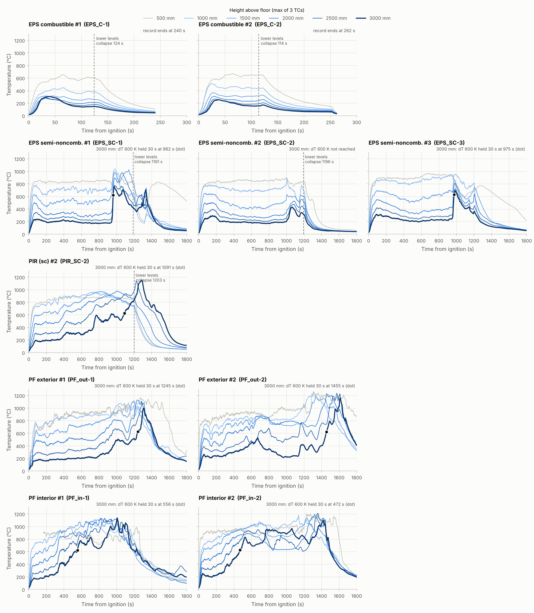
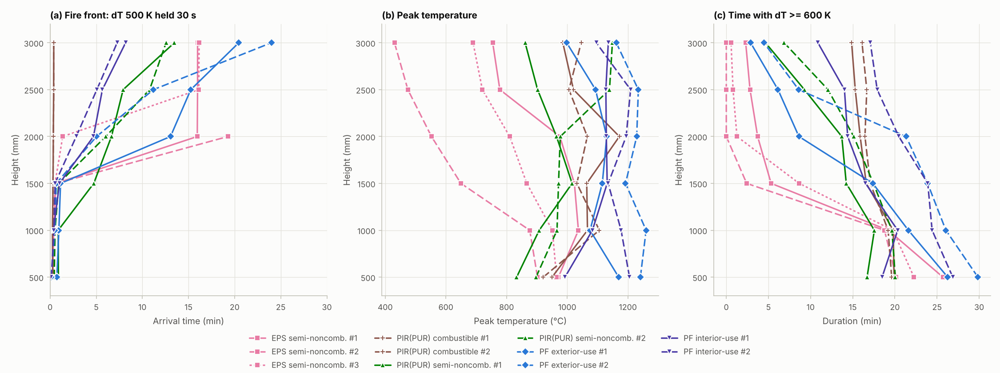
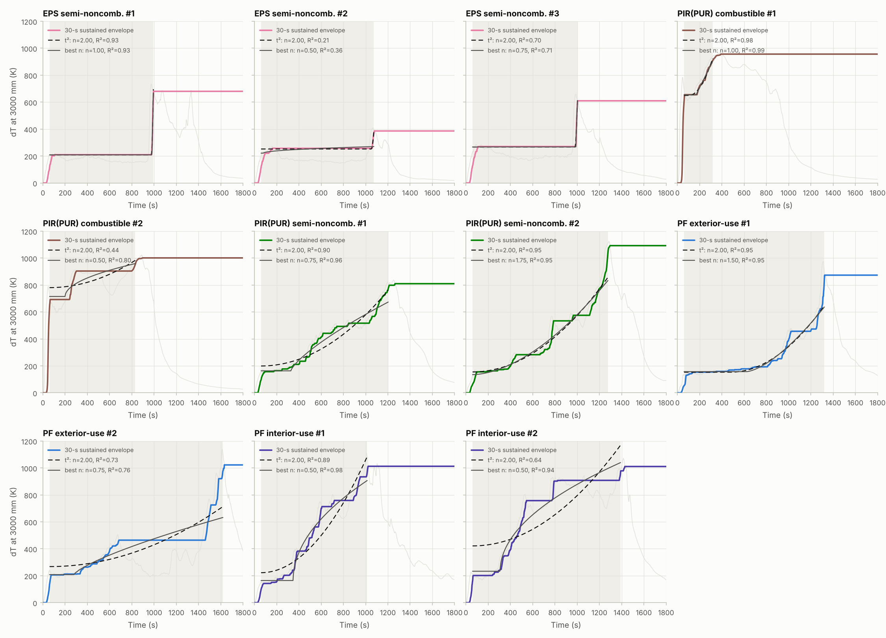
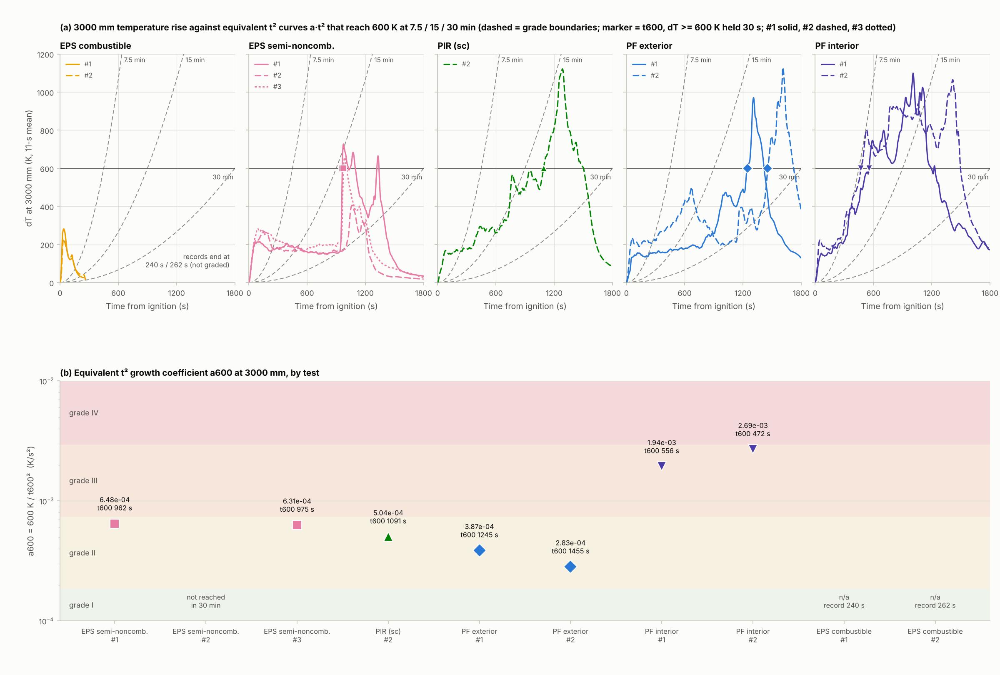
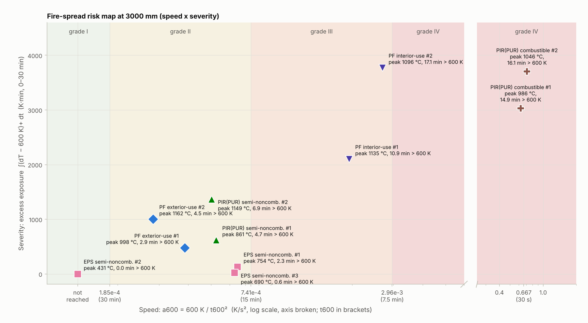
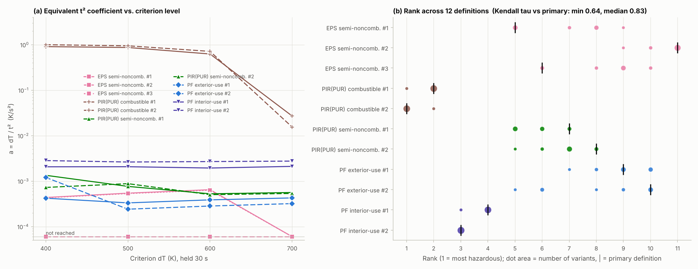

# 중공층(100T) 외단열 재료별 화재확산 경향과 3000 mm 기준 at²형 화재위험지수

대상 자료는 중공층 100 mm + 외부 단열재 100 mm 시험체의 1 Hz 온도로그입니다. 열전대는 높이마다 3개씩, 총 18개입니다(CH1–3 = 500 mm, CH4–6 = 1000 mm, … CH16–18 = 3000 mm).

| 재료 (c = 가연성, sc = 준불연성) | 시트 | 시험 ID |
|---|---|---|
| EPS 가연성 | `(1)(2) EPS_C` | EPS_C-1, -2 (4분 기록, 판정 제외) |
| EPS 준불연 | `(1)(2)(3) EPS_SC` | EPS_SC-1, -2, -3 |
| PIR(PUR) 가연성 | `(1)(2) PIR_c` | PIR_C-1, -2 |
| PIR(PUR) 준불연 | `(1)(2) PIR_sc` | PIR_SC-1, -2 |
| PF 준불연 외부용 | `(0)(1)(2) PF_semi_out` | PF_out-0(제외), -1, -2 |
| PF 준불연 내부용 | `(1)(2) PF_semi_in` | PF_in-1, -2 |

- PIR은 PUR 계열로 보고 'PIR(PUR)'로 표기합니다. PF는 준불연만 있고, out = 외부용, in = 내부용입니다.

모든 수치·그림은 `python analysis.py`로 재현됩니다(→ [부록](#부록-재현-방법과-산출물)). 그림 안의 글자는 영문입니다.

## 0. 결론 – "3000 mm에서 at² 같은 지표를 만들 수 있는가?"

**만들 수 있습니다.** 다만 온도곡선에 at²를 *맞추는*(fitting) 방식은 재료마다 곡선 모양이 달라 객관적이지 않습니다(§3). 그래서 at²의 **원래 정의 방식**을 그대로 빌려 왔습니다. NFPA 72/92의 t² 화재는 α를 곡선 적합으로 구하지 않습니다. 기준 발열량(1055 kW)에 도달하는 시간 t_g로 **α = 1055 kW / t_g²** 라고 *정의*합니다.

### 제안 지표: 3000 mm 등가 t² 화재확산계수 α₆₀₀

> **α₆₀₀ = 600 K / t₆₀₀²**  [K/s²]
>
> t₆₀₀ = 점화(t = 0)부터, 3000 mm 온도상승 ΔT(3개 열전대 중 최댓값 − 초기온도)가 **600 K 이상으로 30초 이상 지속**되기 시작한 시각

- **600 K·30 s**: BS 8414/BR 135(및 이를 준용한 KS F 8414 계열 실물모형시험)의 레벨 2 화재확산 판정 개념과 같습니다. 측정점이 중공층 내부이므로 '내부 화재확산' 판정에 해당합니다.
- **3개 중 최댓값**: 위 판정의 "어느 열전대라도" 규칙과 같습니다. 높이마다 가운데 열전대(중공층 중앙)가 거의 항상 가장 뜨거우므로 사실상 중공층 중앙 온도입니다.
- **곡선 적합이 없음**: 적합 구간·원점·지수를 고를 필요가 없어 누가 계산해도 같은 값이 나옵니다.

**등급(제안)** – NFPA의 t_g 사다리(75·150·300·600 s, 2배 간격)와 같은 방식입니다. 기준을 BS 8414의 15분과 시험시간 30분에 맞췄습니다.

| 등급 | t₆₀₀ | α₆₀₀ (K/s²) | 의미 |
|---|---|---|---|
| IV 매우 빠름 | ≤ 7.5 min (450 s) | ≥ 2.96×10⁻³ | |
| III 빠름 | 7.5–15 min | 7.41×10⁻⁴ – 2.96×10⁻³ | 15분 안에 기준 도달(BS 8414식 판정이면 부적합에 해당) |
| II 보통 | 15–30 min | 1.85×10⁻⁴ – 7.41×10⁻⁴ | |
| I 미도달 | 30분 안에 미도달 | < 1.85×10⁻⁴ | |

### 결과 요약 (3000 mm)

| 재료 | 시험 | t₆₀₀ | α₆₀₀ (×10⁻⁴ K/s²) | 등급 | 최고온도 | ΔT ≥ 600 K 지속 | 초과 노출량 H₆₀₀ (K·min) |
|---|---|---|---|---|---|---|---|
| **PIR(PUR) 가연성** | PIR_C-2 | **29 s** | **7134** | **IV** | 1046 °C | 16.1분 | **3704** |
| | PIR_C-1 | **31 s** | **6244** | **IV** | 986 °C | 14.9분 | **3029** |
| **PF 준불연 내부용** | PF_in-2 | **472 s (7.9분)** | **26.9** | **III** | 1096 °C | 17.1분 | **3769** |
| | PF_in-1 | **556 s (9.3분)** | **19.4** | **III** | 1135 °C | 10.9분 | **2098** |
| EPS 준불연 | EPS_SC-1 | 962 s (16.0분) | 6.48 | II | 754 °C | 2.3분 | 129 |
| | EPS_SC-3 | 975 s (16.3분) | 6.31 | II | 690 °C | 0.6분 | 20 |
| | EPS_SC-2 | 미도달 | < 1.85 | I | 431 °C | 0 | 0 |
| PIR(PUR) 준불연 | PIR_SC-1 | 1068 s (17.8분) | 5.26 | II | 861 °C | 4.7분 | 616 |
| | PIR_SC-2 | 1091 s (18.2분) | 5.04 | II | 1149 °C | 6.9분 | 1366 |
| PF 준불연 외부용 | PF_out-1 | 1245 s (20.8분) | 3.87 | II | 998 °C | 2.9분 | 475 |
| | PF_out-2 | 1455 s (24.3분) | 2.83 | II | 1162 °C | 4.5분 | 999 |
| EPS 가연성 | EPS_C-1, -2 | – | – | **판정 불가** | 306 / 253 °C | 0 | 0 |

- 초과 노출량 H₆₀₀ = ∫(ΔT − 600 K)₊ dt (0–30분)입니다.
- EPS 가연성은 기록이 240 s·262 s뿐이라 판정할 수 없습니다(§1).
- PIR(PUR) 가연성의 α₆₀₀은 IV등급 경계(2.96×10⁻³)의 약 200배입니다. 등급표의 최상단보다 훨씬 위에 있습니다.

**재료별 화재위험 순위(3000 mm)**

1. **PIR(PUR) 가연성**: 유일한 IV등급(2/2)입니다. 점화 15–25 s 만에 500–3000 mm 전 높이가 동시에 화염에 잠기고(t₆₀₀ 29–31 s), 이후 15–16분 동안 3000 mm가 600 K 이상입니다. 다른 모든 재료와 차원이 다른 위험입니다.
2. **PF 준불연 내부용**: 준불연 재료 중 유일한 III등급(2/2)입니다. 준불연 중 가장 빠르고(t₆₀₀ 8–9분), 가장 오래·넓게 탑니다(600 K 이상 11–17분, 3000 mm 열전대 3개 중 2–3개가 도달).
3. **등급 II 그룹**은 속도(α₆₀₀) 차이가 작습니다. 이 순서는 기준온도를 바꾸면 뒤바뀌므로(§6) **심각도(H₆₀₀)로 구분**하는 것이 타당합니다.
   - **PIR(PUR) 준불연**(616–1366) > **PF 준불연 외부용**(475–999) > **EPS 준불연**(0–129)
   - 단, EPS 준불연은 **약 16분에 중공층 전체가 수 초 만에 동시에 착화하는 "돌발형"**입니다(ΔT 300→600 K가 8–13 s). 속도등급만으로는 이 위험이 드러나지 않으므로, 보조지표 τ₃₀₀→₆₀₀을 함께 보고하시길 권합니다.
4. **EPS 가연성**은 현재 자료로 판정할 수 없습니다. 30분 원본 기록이 필요합니다(§1).

**보고 형식 제안**: "α₆₀₀ = 1.94×10⁻³ K/s² (등급 III), H₆₀₀ = 2,098 K·min, τ₃₀₀→₆₀₀ = 218 s"처럼 **속도등급 + 심각도 + 급격도**를 함께 씁니다.

> ⚠ α₆₀₀의 단위는 K/s²입니다. 발열량 기반 α(kW/s², slow/medium/fast/ultra-fast)와 **같은 값이 아닙니다.** kW/s²로 분류하려면 산소소모법 HRR 자료가 필요하며, 같은 절차(기준값 / t_g²)를 그대로 적용하면 됩니다.

---

## 1. 데이터 품질점검 – 원본 엑셀에서 발견된 문제 (확인 부탁드립니다)

시트 간 행 단위 비교로 **다른 시험의 데이터가 붙여넣어진 구간**을 자동 검출했습니다(`find_splices`). 붙여넣어진 시점에는 18채널 합계 2,482–3,161 °C의 불연속 점프가 있습니다. 평소 1 s 변화는 9–21 °C입니다.

| 시트 | 문제 | 처리 |
|---|---|---|
| `(2) EPS_C` | **263 s 이후 1,564행이 `(1) PF_semi_out`과 완전히 동일**(PF 외부용 #1 데이터) | 0–262 s만 사용 |
| `(1) EPS_SC` | 1807–1826 s의 20행이 `(2) PF_semi_out`과 동일 | 0–1806 s만 사용 |
| `(2) EPS_SC` | 1808–1826 s가 `(1) PF_semi_in` 데이터를 한 열 밀려서 붙인 것(CH1 열에 시간 값) | 0–1807 s만 사용 |
| `(1) PF_semi_in` | CH2(500 mm 중앙)가 0–167 s 동안 `-------`·`BURNOUT`(단선)·음수 | 500 mm를 167 s까지 결측 처리 |
| `(1) PF_semi_out` | CH14(2500 mm 중앙) 418–453 s 결측(36 s) | 선형보간 |
| `(3) EPS_SC` | 시간 열이 1828행부터 분→초로 바뀜 | 1 Hz 행 번호를 시간으로 사용(모든 시트 공통) |
| `(0) PF_semi_out` | 기록 184 s뿐이고, 1 s에 이미 500 mm 669 °C·1000 mm 565 °C(점화 후 기록 시작 또는 예비시험으로 추정) | **분석 제외** |
| `(1)(2) EPS_C` | 기록 240 s·262 s뿐이고, 114–124 s에 500 mm가 약 650 °C → 160 °C 이하로 떨어짐(버너 정지 추정). #1은 시험 오류로 확인됨 | **등급 판정 제외**(초기 거동만 비교) |
| `(1) PIR_c` | 1929 s에서 시간값이 반복되고(1929 두 번) 온도가 불연속(500 mm 중앙 32 → 114 °C). 이후 689행은 다른 기록이 이어 붙은 것으로 판단(다른 시트와 일치하지 않음, 출처 미상) | 0–1929 s만 사용(30분 평가에 영향 없음) |
| `(2) PIR_sc` | 이전에 받은 `sc_2 max`(높이별 최댓값만) 파일과 값이 완전히 같음 | 이제 CH1–18 원자료로 계산 |

- 엑셀의 높이별 열(`EPS_1c_500`, `PIR_c1_500` 등)은 해당 높이 3개 채널의 최댓값과 일치합니다. 분석에서는 CH1–18에서 직접 다시 계산했습니다.
- 높이마다 가운데 채널(CH2·5·8·…·17)이 가장 뜨거운 비율은 대부분 85–100 %입니다(PF_in-1의 2500·3000 mm 73·59 %, PIR_C-2의 1500–2500 mm 78–87 %). 가운데 채널이 중공층 중앙·화원 중심선 위에 있는 것으로 보입니다.

## 2. 재료별 화재확산 경향





**화재전선 도달시간** – ΔT 500 K가 30 s 지속된 시각(s)입니다.

| 시험 | 500 | 1000 | 1500 | 2000 | 2500 | 3000 mm | 2000→3000 mm 전선속도 |
|---|---|---|---|---|---|---|---|
| EPS_SC-1 | 18 | 23 | 38 | 957 | 959 | 959 | 동시(2 s 이내) |
| EPS_SC-2 | 22 | 22 | 40 | 1157 | – | – | – |
| EPS_SC-3 | 17 | 20 | 32 | 82 | 967 | 969 | 동시(2 s) |
| PIR_C-1 | 17 | 15 | 19 | 21 | 23 | 24 | 전 높이 동시(25 s 이내) |
| PIR_C-2 | 22 | 18 | 19 | 21 | 24 | 23 | 전 높이 동시(25 s 이내) |
| PIR_SC-1 | 54 | 53 | 284 | 399 | 475 | 808 | 2.2 mm/s |
| PIR_SC-2 | 27 | 32 | 56 | 362 | 647 | 754 | 2.4 mm/s |
| PF_out-1 | 44 | 57 | 68 | 783 | 915 | 1227 | 2.1 mm/s |
| PF_out-2 | 7 | 31 | 40 | 302 | 672 | 1439 | 0.85 mm/s |
| PF_in-1 | (센서) | 22 | 61 | 282 | 340 | 491 | **4.5 mm/s** |
| PF_in-2 | 8 | 25 | 32 | 170 | 304 | 436 | **3.8 mm/s** |

- PIR(PUR) 가연성을 뺀 나머지는 0.5–1.5 m가 1분 안에 화원 화염에 잠깁니다. 따라서 **준불연 재료 간 차이는 2000 mm 이상에서 나타납니다.**
- 3000 mm는 화원만으로는 ΔT 약 155–290 K(초기 2분 최대)에 그칩니다. **3000 mm에서 600 K가 30초 이상 지속되면 재료 자체가 연소에 가담해 화재가 확산된 것**으로 볼 수 있습니다. 3000 mm를 평가 지점으로 쓰는 근거입니다.

### 재료별 확산 유형

**PIR(PUR) 가연성 – 즉시 전면 화염형(가장 위험)**
- 점화 15–25 s 만에 500–3000 mm 전 높이가 **동시에** ΔT 500 K를 넘습니다. 화재전선이 위로 '이동'하는 것이 아니라 중공층 전체가 한꺼번에 화염에 잠깁니다. 3000 mm 600 K 도달은 29–31 s, τ₃₀₀→₆₀₀은 11–12 s입니다.
- 이후 3000 mm가 15–16분 동안 600 K 이상이고(최고 986–1046 °C), 3000 mm 열전대 3개 중 2–3개가 도달합니다.
- 약 15–17분부터 상부 온도가 떨어집니다. 버너가 꺼지기(1170–1193 s) 전에 연료가 대부분 소진된 것으로 보이며, 버너 소화 후 자립 연소는 없습니다([연계 분석](../coupled_analysis/README.md)).
- 준불연 PIR(PUR)과 TGA 곡선은 비슷한데(공기 중 분해 시작온도는 오히려 가연성이 높음) 중공층 거동은 완전히 다릅니다. 준불연 등급의 난연 효과가 TGA 질량감소로는 드러나지 않는다는 뜻입니다([통합 평가식](../integrated_model/README.md)).

**PF 준불연 내부용 – 조기·점진 확산형(준불연 중 가장 위험)**
- 연소대가 처음부터 위로 올라가며, 2000→3000 mm 전선속도가 3.8–4.5 mm/s로 준불연 PIR(PUR)의 1.6–2.1배입니다.
- 3000 mm가 7.9–9.3분에 600 K에 도달하고, 이후 10–17분 동안 600 K 이상을 유지합니다.
- 3000 mm 성장은 감속형(n ≈ 0.5)입니다. 빨리 올라가서 약 1000 °C 부근에서 포화합니다.

**PIR(PUR) 준불연 – 이동 연소대형**
- 연소대가 2.2–2.4 mm/s로 일정하게 올라갑니다. 3000 mm 도달(1068·1091 s)의 반복성이 가장 좋습니다(차이 2 %).
- 3000 mm는 #2가 t² 성장에 가장 가깝고(n = 1.75, R² 0.95), #1은 n = 0.75입니다.
- 하부가 급랭한 직후(1197·1203 s) 상부가 오히려 861·1149 °C까지 치솟습니다. 기존 [`hollow_layer_fire`](../hollow_layer_fire/README.md) 분석과 같은 결과입니다.

**PF 준불연 외부용 – 지연·점진형**
- 상향 확산이 느립니다(0.85–2.1 mm/s). 3000 mm 기준 도달이 20.8·24.3분으로 가장 늦습니다.
- 그러나 일단 도달하면 998–1162 °C까지 오릅니다.
- 하부가 가장 오래 탑니다. 500 mm의 ΔT 600 K 이상 지속시간이 26–30분(시험 거의 전체)입니다. 하부 동시 급랭은 검출되지 않았습니다.

**EPS 준불연 – 지연·돌발형(동시 착화)**
- 약 16분(954–969 s)까지는 화원만으로 형성된 정체 온도장이 유지됩니다.
- 그 순간 1500/2000–3000 mm가 **수 초 안에 동시에** 급상승합니다(3000 mm ΔT 300→600 K가 8–13 s). 연소대가 위로 '전파'된 것이 아니라 중공층 상부 전체가 한꺼번에 착화한 양상입니다. 보호층 파손 후 축적된 열분해가스나 용융 EPS가 착화했을 가능성이 있습니다(추정, 영상 확인 필요).
- 고온 지속은 짧습니다(0.6–2.3분, 최고 690–754 °C). 3000 mm 열전대 3개 중 1–2개만 600 K에 도달해 국부적입니다.
- #2는 300 K까지만 도달해 **반복시험 간 편차가 큽니다.**
- #1·#3은 하부 급랭 뒤 500 mm가 다시 770–830 °C까지 오릅니다(약 1270–1450 s). 바닥에 떨어진 용융 EPS의 연소(pool fire)로 추정됩니다.

**EPS 가연성 – 판정 불가**
- 500 mm 최고온도가 655–673 °C로 다른 시험체(850–1000 °C)보다 낮습니다.
- 1500–3000 mm가 30–40 s 만에 250–360 °C로 거의 같은 온도로 오른 뒤 떨어집니다. 화염이 위로 전파되기보다 고온가스가 중공층을 채우는 양상입니다. EPS가 녹아 열원에서 멀어진 결과일 수 있습니다(추정).
- 두 시험 모두 114–124 s에 하부가 동시 급랭하고(버너 정지 추정) 기록이 4분에서 끝나므로, 30분 기준 지표와 비교할 수 없습니다. #1은 시험 오류로 확인되었고, #2는 263 s 이후 원본 기록이 엑셀에서 덮어써졌습니다.

**하부 동시 급랭(버너 정지) 시각**: EPS_SC-1 1191 s, EPS_SC-2 1196 s, PIR_C 1170·1193 s, PIR_SC 1197·1203 s로 모두 약 20분에 모여 있습니다(30 kW 버너 20분 조건). EPS_SC-3·PF 시험에서는 검출되지 않았습니다. PF는 버너가 꺼진 뒤에도 스스로 연소를 이어갔기 때문입니다([연계 분석](../coupled_analysis/README.md)).

## 3. 온도곡선에 at²를 직접 적합하면 안 되는 이유



3000 mm 30초 지속온도 포락선에 꺾은선 멱함수 ΔT = b + a(t − tᵢ)ⁿ를 적합한 결과입니다(60 s – 최댓값 95 % 도달 시점).

| 시험 | 최적 n | R² | t² 고정 시 a (K/s²) | t² R² | 곡선 형태 |
|---|---|---|---|---|---|
| EPS_SC-1 / -3 | (계단) | 0.93 / 0.71 | **1.35 / 0.68** | 0.93 / 0.70 | 돌발형(계단) |
| EPS_SC-2 | – | 0.36 | 0.23 | 0.21 | 적합 불가 |
| PIR_C-1 / -2 | 1.0 / 0.5 | 0.99 / 0.80 | 6.0×10⁻³ / 3.4×10⁻⁴ | 0.98 / 0.44 | 60 s에 이미 600 K 이상(적합 구간 밖) |
| PIR_SC-1 | 0.75 | 0.96 | 4.3×10⁻⁴ | 0.90 | 감속형에 가까움 |
| PIR_SC-2 | 1.75 | 0.95 | 4.7×10⁻⁴ | 0.95 | t²에 근접(가속형) |
| PF_out-1 | 1.5 | 0.95 | 6.9×10⁻⁴ | 0.95 | t²에 근접(가속형) |
| PF_out-2 | 0.75 | 0.76 | 1.8×10⁻⁴ | 0.73 | 불규칙(2단) |
| PF_in-1 | 0.5 | 0.98 | 9.5×10⁻⁴ | 0.89 | 감속형 |
| PF_in-2 | 0.5 | 0.94 | 4.2×10⁻⁴ | 0.64 | 감속형 |

- t²가 잘 맞는 시험은 **PIR_SC-2와 PF_out-1뿐**입니다. PF 준불연 내부용은 감속형(n ≈ 0.5), EPS 준불연은 계단형입니다.
- 적합한 a로 순위를 매기면 EPS 준불연(계단 → a = 0.7–1.3 K/s²)이 PF 준불연 내부용보다 **수백–수천 배 위험**하게 나옵니다. 가장 빠른 준불연인 PF_in-2(4.2×10⁻⁴)는 PIR_SC-2(4.7×10⁻⁴)보다 *덜* 위험하게 나오고, 가장 위험한 PIR_C-2(3.4×10⁻⁴)는 그보다도 낮게 나와 실제와 순서가 뒤집힙니다.
- 따라서 적합 계수는 객관적 지표가 될 수 없습니다. **α₆₀₀처럼 "기준값 / 도달시간²"으로 정의**해야 곡선 형태와 상관없이 비교할 수 있습니다. 적합 결과는 성장 *형태*를 설명하는 보조정보로만 쓰십시오.

## 4. 제안 지표 α₆₀₀의 결과



- (a) 점선은 600 K에 7.5·15·30분에 도달하는 등가 t² 곡선(등급 경계)입니다. 각 시험의 3000 mm 곡선이 600 K선을 지속적으로 넘는 지점(마커)이 어느 구간에 있는지로 등급이 정해집니다.
- (b) 시험별 α₆₀₀(로그축)입니다. PIR(PUR) 가연성 2개는 IV등급(경계의 약 200배), PF 내부용 2개는 III등급, 나머지 준불연(EPS #1·#3, PIR(PUR), PF 외부용)은 II등급, EPS 준불연 #2는 I등급입니다.

## 5. 보조지표와 위험도 지도(속도 × 심각도)



| 시험 | τ₃₀₀→₆₀₀ (급격도) | 3000 mm 600 K 도달 TC | 전선속도 2000→3000 mm | H₆₀₀ (K·min) |
|---|---|---|---|---|
| PIR_C-2 | **11 s** | 2/3 | 전 높이 동시 | 3704 |
| PIR_C-1 | **12 s** | 3/3 | 전 높이 동시 | 3029 |
| PF_in-2 | 173 s | 2/3 | 3.8 mm/s | 3769 |
| PF_in-1 | 218 s | 3/3 | 4.5 mm/s | 2098 |
| PIR_SC-2 | 426 s | 1/3 | 2.4 mm/s | 1366 |
| PIR_SC-1 | 594 s | 1/3 | 2.2 mm/s | 616 |
| PF_out-2 | 995 s | 2/3 | 0.85 mm/s | 999 |
| PF_out-1 | 314 s | 1/3 | 2.1 mm/s | 475 |
| EPS_SC-1 | **8 s** | 2/3 | 동시 착화 | 129 |
| EPS_SC-3 | **13 s** | 1/3 | 동시 착화 | 20 |
| EPS_SC-2 | – | 0/3 | – | 0 |

- **τ₃₀₀→₆₀₀** = t₆₀₀ − t₃₀₀입니다. 화원 수준(약 300 K)을 넘어선 뒤 기준에 닿기까지의 시간으로, 짧을수록 경고 없이 갑자기 번집니다.
- **3000 mm 600 K 도달 TC**는 3개 열전대 중 몇 개가 600 K·30 s에 도달했는지로, 화재의 수평 범위를 나타냅니다.
- 위험도 지도는 속도축을 끊어서 그렸습니다(PIR(PUR) 가연성이 다른 시험보다 두 자릿수 이상 빠르기 때문).
- PIR(PUR) 가연성은 맨 오른쪽 위(압도적으로 빠르고 심함), PF 내부용은 III등급 위쪽입니다. PIR(PUR) 준불연·PF 외부용은 II등급의 가운데 높이(늦지만 일단 도달하면 심함), EPS 준불연은 II등급 오른쪽 아래(비교적 빠르지만 짧고 국부적)입니다.

**재료별 요약**(30분 시험 기준)

| 재료 | 시험 수 | 600 K 도달 | t₆₀₀ 범위 | α₆₀₀ 범위 (×10⁻⁴) | 등급 | 평균 최고온도 | 평균 H₆₀₀ |
|---|---|---|---|---|---|---|---|
| PIR(PUR) 가연성 | 2 | 2/2 | 29–31 s | 6244–7134 | IV / IV | 1016 °C | 3367 |
| PF 준불연 내부용 | 2 | 2/2 | 472–556 s | 19.4–26.9 | III / III | 1116 °C | 2933 |
| PIR(PUR) 준불연 | 2 | 2/2 | 1068–1091 s | 5.04–5.26 | II / II | 1005 °C | 991 |
| PF 준불연 외부용 | 2 | 2/2 | 1245–1455 s | 2.83–3.87 | II / II | 1080 °C | 737 |
| EPS 준불연 | 3 | 2/3 | 962–975 s | < 1.85 – 6.48 | II / I / II | 625 °C | 50 |
| EPS 가연성 | (2) | – | – | – | 판정 불가 | 279 °C (4분 기록) | – |

## 6. 객관성(강건성) 검증



기준온도(400·500·600·700 K) × 지속시간(1·10·30 s), 12가지 정의로 α를 다시 계산해 순위를 비교했습니다(`results/robustness.csv`).

- **지속시간(1·10·30 s)은 결과에 거의 영향이 없습니다.** 600 K에서는 세 정의의 순위가 완전히 같습니다.
- **양 끝은 정의와 무관합니다.**
  - PIR(PUR) 가연성 2개는 12개 정의 모두에서 1–2위, PF 내부용 2개는 3–4위입니다.
  - EPS_SC-2는 모든 정의에서 하위권(9–11위)입니다.
- **가운데 그룹(EPS 준불연 #1·#3, PIR(PUR) 준불연, PF 외부용)의 순서는 기준온도에 따라 바뀝니다.**
  - 400 K에서는 서서히 예열되는 PF_out-2·PIR(PUR) 준불연이, 500 K에서는 PIR(PUR) 준불연이 EPS 준불연보다 앞섭니다.
  - 600–700 K에서는 한 번에 치솟는 EPS 준불연이 앞섭니다.
  - 주요 정의 대비 Kendall τ는 최소 0.64, 중앙값 0.83입니다.
- 그러므로 **기준온도는 규약으로 고정해야 하며**(600 K = 판정기준), 같은 등급 안의 미세한 α 차이로 순위를 매기지 말고 심각도(H₆₀₀)로 구분하는 것이 객관적입니다.
- 등급 일치율(12개 정의 중 주요 정의와 같은 등급인 비율)은 PIR_C·PF_out-1 100 %, EPS_SC-1 92 %, EPS_SC-2 83 %, EPS_SC-3·PF_in-1 75 %, PF_out-2 67 %, PIR_SC·PF_in-2 50 %입니다. 기준온도를 바꾸면 PIR(PUR) 준불연은 III, PF_in-2는 IV로 한 등급 오릅니다.

## 7. 한계와 확인 요청 사항

1. **EPS 가연성 자료**: 두 시험 모두 4분 기록이고, 약 2분에 하부가 동시에 급랭합니다. #1은 시험 오류로 확인되었습니다. #2는 263 s 이후가 PF 외부용 #1 자료로 덮어써져 있으므로, **덮어쓰기 전 데이터로거 원본 파일**이 있으면 바로 분석할 수 있습니다. 2분에 버너를 끈 사유(급격한 확산·용융 낙하 등)도 함께 알려 주시면 해석에 반영하겠습니다.
2. **`(0) PF_semi_out`**: 184 s만 있고 1 s부터 화염온도입니다. 이 시험에서는 3000 mm가 150 s에 ΔT 500 K, 3분 안에 1103 °C에 도달해 PF_out-1·-2와 전혀 다릅니다. 예비시험인지, 점화 후 기록을 시작했는지 확인 부탁드립니다.
3. **화원 가동시간**: 30 kW 버너 20분 조건이므로, EPS 준불연·PIR(PUR)의 약 20분(1170–1203 s) 하부 동시 급랭은 버너 정지입니다. PF는 같은 시점에 급랭이 없으므로, PF 준불연 외부용의 20.8·24.3분 기준 도달과 하부 25–30분 연소는 **버너 없이 PF가 스스로 연소를 지속**한 결과입니다. 이는 중요한 위험 요인입니다([연계 분석](../coupled_analysis/README.md) §4.4).
4. **반복 수**: 재료당 2–3회입니다. EPS 준불연은 2/3만 도달할 정도로 편차가 커서, 재료 간 차이의 통계적 유의성은 아직 말할 수 없습니다. 같은 형식의 엑셀이면 `analysis.py`로 바로 추가 분석됩니다.
5. **`(1) PIR_c`의 1929 s 이후 기록**: 다른 기록이 이어 붙은 것으로 보입니다(§1). 30분 평가에는 영향이 없지만, 원래 어떤 기록인지 확인해 주시면 좋겠습니다.
6. **등급 경계(7.5·15·30분)는 제안값**입니다. 규제·인증 기준이 아니라 비교용 지표입니다. 시험법(측정 높이 3 m, 화원 조건)이 BS 8414/KS F 8414(레벨 2 = 개구부 상단 5 m)와 다르므로, 판정 대신 상대 비교에 쓰십시오.
7. 확산 유형 해석(보호층 파손, 용융 EPS 연소 등)은 온도만으로 추정한 것입니다. **시험 영상·관찰기록**과 대조해 주십시오.

## 8. 다음 단계 – 열물성 기반 외벽 화재위험 평가식

비열·밀도·열전도율(k·ρ·c), 착화온도, 발열량으로 α₆₀₀와 외벽 위험등급(FRI)을 예측하는 평가식과 보정 절차는 [RISK_MODEL.md](RISK_MODEL.md)에 정리했습니다(계산: `python risk_model.py`, 입력: `material_properties.csv`).

---

## 부록: 재현 방법과 산출물

```bash
cd cavity_fire_index
pip install -r requirements.txt
python analysis.py data/EPS.xlsx data/PF.xlsx data/PIR.xlsx   # figures/, results/ 생성
```

- 원본 엑셀(`data/*.xlsx`)은 공개 저장소이므로 커밋하지 않습니다(`.gitignore`). 파일명은 상관없고 시트 이름으로 시험을 식별합니다.
- 주요 상수(`analysis.py` 상단)
  - 기준 600 K: `THETA_REF`
  - 지속 30 s: `SUSTAIN_S`
  - 등급 경계: `GRADE_TG`
  - 평가창 1800 s: `EVAL_END_S`
  - 결측 보간 한도 60 s: `MAX_GAP_S`
- 산출물(`results/`)
  - `index_3000mm.csv` – 시험별 3000 mm 지표(t₃₀₀…t₈₀₀, α₆₀₀·α₅₀₀·포락 α, 등급, τ, 지속시간, H₆₀₀, n_TC, 전선속도, 하부 급랭 시각)
  - `height_metrics.csv` – 시험×높이별 최고온도·도달시간·지속시간·노출량
  - `material_summary.csv` – 재료별 요약
  - `growth_shape_3000mm.csv` – §3 적합 결과
  - `robustness.csv` – 12개 정의별 α·순위·등급
  - `summary.json` – 정의, 데이터 품질점검 로그(붙여넣기 검출·이어 붙은 기록·센서 결함·보간 구간), 전체 결과
  - `risk_model.csv` – `risk_model.py` 결과(실측 FRI, 모델이 요구하는 재료지수 비, 물성 입력 시 보정·예측값)
