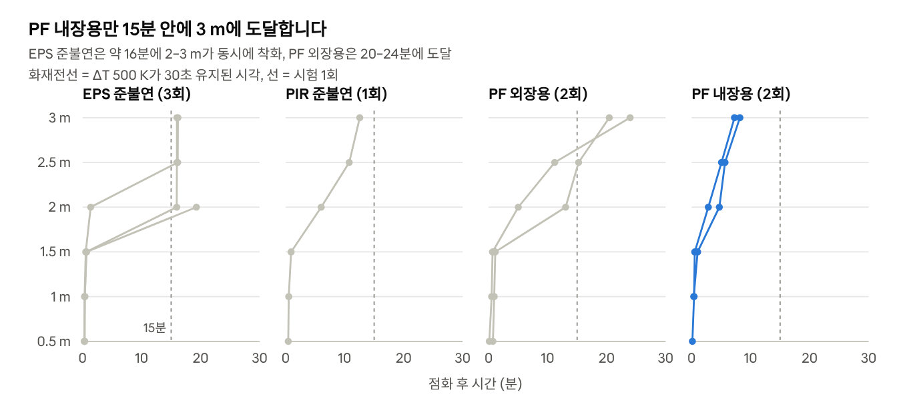
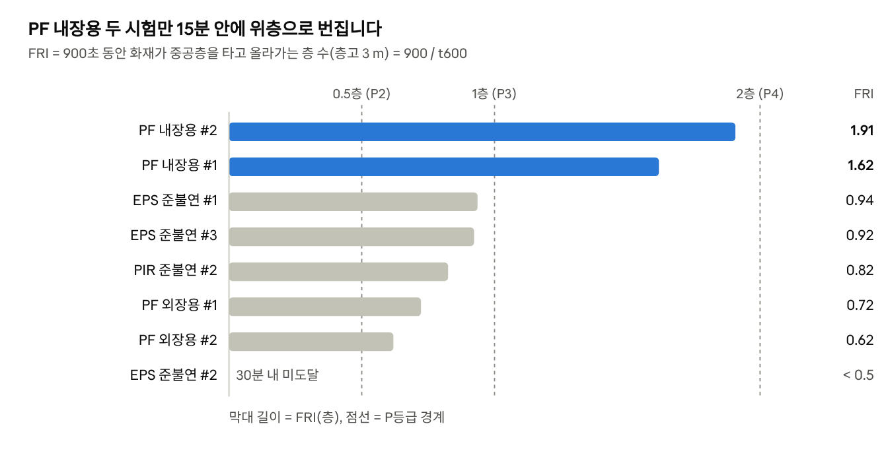
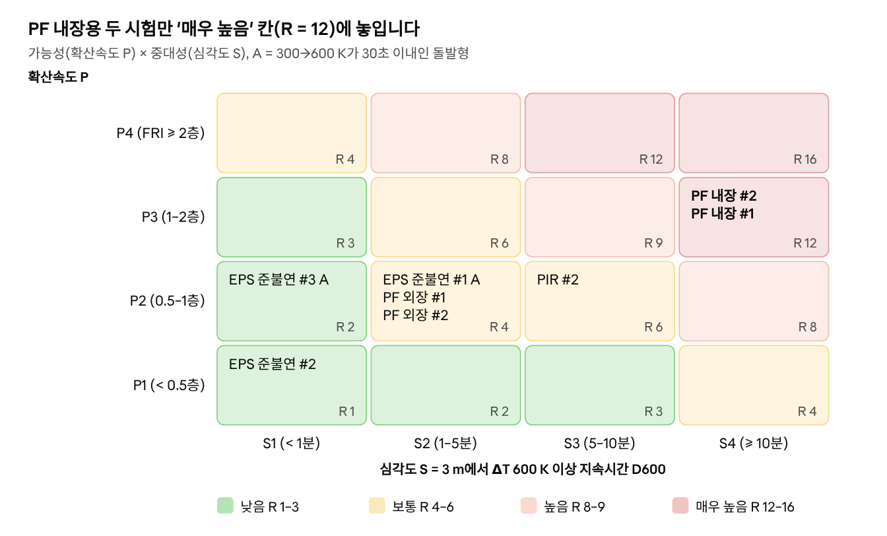

# 중공층 외단열 화재확산 위험평가식 제안 (최종안)

2026년 10월 9일

## 1. 요약

최종 제안식은 3 m 중공층 시험 자료만으로 계산되는 3단계입니다. ① 등가 t² 화재확산계수 α₆₀₀ → ② 외벽 확산지수 FRI(기준시간 동안 화재가 올라가는 층 수) → ③ 위험도 R = P × S. 이 기준으로 PF 내장용이 \'매우 높음\'(R = 12), PIR·PF 외장용·EPS 준불연이 \'보통\'(R = 4--6)입니다.

$$\alpha_{600} = \frac{\Delta T_c}{t_{600}^{2}}, \qquad \Delta T_c = 600\ \mathrm{K}$$

$$\mathrm{FRI} = t_{ref}\sqrt{\frac{\alpha_{600}}{\Delta T_c}} = \frac{t_{ref}}{t_{600}}, \qquad t_{ref} = 900\ \mathrm{s}$$

$$R = P(\mathrm{FRI}) \times S(D_{600})$$

-   t₆₀₀: 점화 후 3000 mm 온도상승(3개 열전대 중 최댓값)이 600 K 이상으로 30초 넘게 유지되기 시작한 시각

-   P: FRI로 정한 확산속도 등급(1--4), S: 3000 mm에서 600 K 이상이 유지된 누적시간 D₆₀₀으로 정한 심각도 등급(1--4)

-   반복시험 중 가장 불리한 값으로 재료를 판정합니다(보수적 판정).

| 재료             | 판정 시험 | α₆₀₀ (×10⁻⁴ K/s²) | FRI (층) | P   | D₆₀₀ (분) | S   | R   | 위험수준            |
|----------------|-----------|-----------|--------|-----|---------|-----|-----|--------------------|
| PF 내장용 준불연 | PF_in-2   | 26.9              | 1.91     | 3   | 17.1      | 4   | 12  | 매우 높음           |
| PIR 준불연       | PIR_SC-2  | 5.04              | 0.82     | 2   | 6.9       | 3   | 6   | 보통                |
| PF 외장용 준불연 | PF_out-1  | 3.87              | 0.72     | 2   | 2.9       | 2   | 4   | 보통                |
| EPS 준불연       | EPS_SC-1  | 6.48              | 0.94     | 2   | 2.3       | 2   | 4   | 보통, 돌발형(A)     |
| EPS 가연성       | --        | --                | --       | --  | --        | --  | --  | 판정 불가(기록 4분) |

재료 물성(k·ρ·c·착화온도·발열량) 연계식(6장)은 지금은 PIR 기준 상대식까지만 세울 수 있습니다. 콘 시험 자료가 들어오면 바로 보정됩니다.

**기존 이론과 본 연구 제안의 구분** --- **신규**는 본 연구가 새로 정의한 식이고, **기존**은 논문에서 출처를 반드시 인용해야 하는 이론·기준입니다. 신규 여부는 본 연구의 문헌조사 범위 기준이며, 체계적 문헌조사로 확인해야 합니다.

| 식                                        | 구분                      | 근거와 새로운 점                                                                                        |
|---------------------------------|---------------|----------------------------------------------------|
| α₆₀₀ = 600 K / t₆₀₀²                      | **신규**                  | NFPA의 α = 1055 kW / t_g² 정의 방식을 발열량 대신 중공층 3000 mm 온도에 적용한 등가 t² 계수             |
| FRI = t_ref / t₆₀₀, P등급(7.5·15·30분)    | **신규**                  | 3 m를 1개 층으로 보고 기준시간 동안 번지는 층 수로 환산. 등급 경계는 NFPA t_g의 2배 간격 개념을 빌려 옴 |
| D₆₀₀과 S등급(1·5·10분)                    | **신규**                  | 3 m 높이의 고온 지속시간을 심각도로 사용. 경계는 본 시험 분포에 맞춘 제안값                             |
| R = P × S                                 | 형식 기존 + 정의 **신규** | 위험성평가의 \'가능성 × 중대성\' 행렬(기존)에 화재확산 지표 P·S를 새로 정의                             |
| 돌발형 표시 A (τ₃₀₀→₆₀₀ ≤ 30초)           | **신규**                  | 중공층 상부 동시 착화를 점진 확산과 구분                                                                |
| t̂₆₀₀ = t₆₀₀,PIR·(M_PIR / M)², α̂₆₀₀ ∝ M⁴   | **신규**                  | 기존 FPI형 재료지수를 온도 기반 α₆₀₀와 잇고 PIR 시험으로 보정한 관계식                                  |
| t₆₀₀ 판정(ΔT 600 K, 30초 유지)            | 기존 기준 적용            | BS 8414·BR 135(KS F 8414 계열) 레벨 2 판정 개념을 중공층 3000 mm에 적용                                 |
| TRP = ΔT_ig·√(πkρc/4), t_ig = (TRP / q″)² | 기존                      | Tewarson(1994), SFPE 착화 이론                                                                          |
| v = δ_f·q_f″² / TRP², M = Q″\^(1/3) / TRP | 기존                      | Quintiere 계열 상향 화염확산, Tewarson FPI(ASTM E2058)                                                  |
| t² 화재 Q = αt², α = 1055 kW / t_g²       | 기존                      | NFPA 72·92                                                                                              |

## 2. 시험 개요와 데이터 품질

판정에 쓴 시험은 30분 기록이 온전한 8개입니다(EPS 준불연 3, PIR 1, PF 외장용 2, PF 내장용 2). 원본 엑셀에서는 다른 시험 데이터가 붙여넣어진 시트 3개를 자동 검출해 잘라냈습니다.

-   시험체: 중공층 100 mm + 외부 단열재 100 mm

-   측정: 바닥에서 500·1000·1500·2000·2500·3000 mm, 높이마다 열전대 3점(CH1--3 = 500 mm ... CH16--18 = 3000 mm), 1초 간격

-   높이별 값: 3점 중 최댓값. BS 8414 판정의 \'어느 열전대라도\' 규칙과 같고, PIR 파일도 최댓값만 있어 기준을 통일했습니다.

| 시트              | 문제                                               | 처리                         |
|--------------------|--------------------------------------------------|------------------------------|
| \(2\) EPS_C       | 263초 이후 1,564행이 (1) PF_semi_out과 완전히 같음 | 0--262초만 사용              |
| \(1\) EPS_SC      | 1807--1826초 20행이 (2) PF_semi_out과 같음         | 0--1806초만 사용             |
| \(2\) EPS_SC      | 1808--1826초가 (1) PF_semi_in을 한 열 밀어 붙인 것 | 0--1807초만 사용             |
| \(1\) PF_semi_in  | CH2(500 mm)가 0--167초 단선(BURNOUT·음수)          | 500 mm 해당 구간 결측        |
| \(1\) PF_semi_out | CH14(2500 mm) 418--453초 결측                      | 선형보간                     |
| \(3\) EPS_SC      | 시간 열이 중간에 분→초로 바뀜                      | 행 번호(1초)를 시간으로 사용 |
| \(0\) PF_semi_out | 184초뿐이고 1초에 이미 500 mm 669 °C               | 분석 제외(예비시험 추정)     |
| (1)(2) EPS_C      | 기록 240·262초뿐, 약 2분에 하부 동시 급량          | 등급 판정 제외               |

붙여넣기 구간은 다른 시트와 같은 행 번호에서 18채널 값이 완전히 일치하고, 그 시작점에 18채널 합계 2,482--3,161 °C의 불연속 점프가 있어 판별했습니다(평소 1초 변화 9--21 °C).

## 3. 재료별 화재확산 경향

재료 간 차이는 화원 화염이 닿지 않는 2 m 이상에서 갈립니다. 화재전선이 15분 안에 3 m에 도달한 것은 PF 내장용뿐입니다(7.3--8.2분).

{width="16cm"}

-   **PF 내장용 -- 조기·점진 확산형**: 2→3 m 전선속도 3.8--4.5 mm/s로 PIR의 1.6--1.9배입니다. 3 m가 600 K 이상인 시간이 11--17분으로 가장 깁니다.

-   **PIR 준불연 -- 이동 연소대형**: 연소대가 약 2.4 mm/s로 일정하게 올라갑니다. 하부가 급량한 직후(약 1203초) 상부가 1149 °C까지 치솟습니다.

-   **PF 외장용 -- 지연·점진형**: 전선속도 0.85--2.1 mm/s로 느리고 3 m 도달이 20--24분입니다. 도달 후에는 998--1162 °C까지 오르고, 500 mm는 26--30분 동안 600 K 이상입니다.

-   **EPS 준불연 -- 지연·돌발형**: 약 16분까지 화원 온도만 유지되다가 2--3 m가 수 초 안에 동시에 착화합니다. 고온은 0.6--2.3분으로 짧고, #2는 3 m에 도달하지 않아 반복 편차가 큽니다.

-   **EPS 가연성 -- 판정 불가**: 1.5--3 m가 30--40초 만에 250--360 °C로 고르게 올랐다가 떨어지는 고온가스형입니다. 기록이 4분뿐이라 차트와 등급 판정에서 뺐습니다.

## 4. 제안식 ①·② 등가 t² 화재확산계수 α₆₀₀와 외벽 확산지수 FRI \[신규 제안\]

α₆₀₀은 NFPA의 t² 화재가 α = 1055 kW / t_g²로 정의되는 방식을 3000 mm 온도로 옮긴 값입니다. FRI는 이를 \'기준시간 900초 동안 화재가 중공층을 타고 올라가는 층 수\'로 바꾼 값입니다.

$$t_{600} = \min\{\, t \;:\; \Delta T_{3000}(\tau) \ge 600\ \mathrm{K},\ \ t \le \tau \le t + 30\ \mathrm{s} \,\}$$

-   ΔT₃₀₀₀ = 3000 mm 열전대 3점 중 최댓값 − 점화 시점 온도, 시간은 화원 점화(t = 0)부터 쟽니다.

-   600 K·30초는 BS 8414·BR 135(및 이를 준용한 KS F 8414 계열)의 레벨 2 화재확산 판정 개념입니다.

-   시험 높이 3 m는 일반 건축물 한 개 층 높이와 비슷해, t₆₀₀을 \'화재가 한 층을 올라가는 시간\'으로 봅니다.

-   t_ref = 900초는 BS 8414의 15분 판정창입니다. 피난 완료·소방대 도착 시간으로 바꿀 수 있습니다.

온도곡선에 at²를 직접 적합하지 않는 이유는 곡선 모양이 재료마다 다르기 때문입니다. PF 내장용은 감속형(지수 n ≈ 0.5), EPS 준불연은 계단형이라 적합 계수가 수백--수천 배 어긋나고 위험 순서가 뒤집힙니다. 도달시간으로 정의하면 곡선 모양과 상관없이 비교됩니다.

| P (확산속도) | FRI (층) | t₆₀₀           | α₆₀₀ (K/s²)            | 의미                           |
|-------------|-----------|----------------|--------------------------|----------------------------------|
| 4            | ≥ 2      | ≤ 7.5분        | ≥ 2.96×10⁻³            | 기준시간 안에 2개 층 이상 확산 |
| 3            | 1 -- 2   | 7.5 -- 15분    | 7.41×10⁻⁴ -- 2.96×10⁻³ | 기준시간 안에 위층으로 확산    |
| 2            | 0.5 -- 1 | 15 -- 30분     | 1.85×10⁻⁴ -- 7.41×10⁻⁴ | 기준시간 뒤 위층으로 확산      |
| 1            | \< 0.5   | 30분 내 미도달 | \< 1.85×10⁻⁴           | 30분 내 위층 확산 없음         |

등급 경계(7.5·15·30분)는 NFPA t_g 사다리(75·150·300·600초)처럼 2배 간격이며, BS 8414의 15분과 시험시간 30분에 맞춘 제안값입니다.

{width="16cm"}

PF 내장용만 FRI가 1을 넘어 P3입니다. 나머지는 0.62--0.94층으로 P2에 모여 있어, 이 그룹은 5장의 심각도로 구분합니다.

## 5. 제안식 ③ 위험도 R = P × S \[신규 제안\]

위험도는 국내 위험성평가에서 쓰는 \'가능성 × 중대성\' 행렬 형식으로, 확산속도 P와 상층 고온 지속시간 S를 곱합니다. PF 내장용 2개 시험만 R = 12(\'매우 높음\')입니다.

$$D_{600} = \int_{0}^{1800\,\mathrm{s}} \mathbf{1}\left[\Delta T_{3000}(t) \ge 600\ \mathrm{K}\right] dt, \qquad \tau_{300\to600} = t_{600} - t_{300}$$

| 구분             | 1                 | 2           | 3           | 4                  |
|--------------------|--------------------|--------------------|--------------------|--------------------|
| S (심각도), D₆₀₀ | \< 1분(순간·국부) | 1 -- 5분    | 5 -- 10분   | ≥ 10분(지속 연소)  |
| 위험수준, R      | 1 -- 3 낮음       | 4 -- 6 보통 | 8 -- 9 높음 | 12 -- 16 매우 높음 |

-   돌발형 표시 A: τ₃₀₀→₆₀₀ ≤ 30초이면 등급 뒤에 A를 붙입니다. 중공층 상부 전체가 수 초 안에 한꺼번에 착화해 경고 시간이 없다는 뜻입니다.

-   S 경계(1·5·10분)는 현재 시험 분포에 맞춘 제안값입니다. 초과노출량 H₆₀₀ = ∫(ΔT − 600 K)₊ dt는 참고값으로 함께 보고합니다.

| 시험     | P   | S (D₆₀₀)   | R   | 위험수준  | τ₃₀₀→₆₀₀ (초) | H₆₀₀ (K·min) |
|---------------|------|-----------------|------|----------------|-----------------|-----------------|
| PF_in-2  | 3   | 4 (17.1분) | 12  | 매우 높음 | 173           | 3769         |
| PF_in-1  | 3   | 4 (10.9분) | 12  | 매우 높음 | 218           | 2098         |
| PIR_SC-2 | 2   | 3 (6.9분)  | 6   | 보통      | 426           | 1366         |
| PF_out-2 | 2   | 2 (4.5분)  | 4   | 보통      | 995           | 999          |
| PF_out-1 | 2   | 2 (2.9분)  | 4   | 보통      | 314           | 475          |
| EPS_SC-1 | 2   | 2 (2.3분)  | 4   | 보통 A    | 8             | 129          |
| EPS_SC-3 | 2   | 1 (0.6분)  | 2   | 낮음 A    | 13            | 20           |
| EPS_SC-2 | 1   | 1 (0분)    | 1   | 낮음      | --            | 0            |

{width="16cm"}

P2 그룹 안에서도 PIR(S3)이 PF 외장용·EPS 준불연(S1--S2)보다 한 칸 위험합니다. EPS 준불연은 심각도는 낮지만 돌발형(A)이라 경고 시간이 없다는 점을 함께 적습니다.

## 6. 제안식 ④ 재료 열물성 연계식 \[기존 이론 + 신규 연결식\]

비열·밀도·열전도율과 착화 온도상승은 열응답 파라미터 TRP로 묶이고, 이론상 t₆₀₀은 TRP²에 비례합니다. 지금 자료로는 PIR 시험(t₆₀₀ = 1091초)을 기준으로 한 상대식까지 세울 수 있습니다.

1.  표면 온도상승: ΔT_s = 2q″√t / √(πkρc). 물성은 곱 kρc(열관성)로만 들어갑니다.

2.  착화시간: ΔT_s가 ΔT_ig에 닿는 시간 t_ig = (TRP / q″)² (Tewarson).

3.  상향 화염확산속도: v = δ_f·q_f″² / TRP². 화염 크기는 열방출률 Q″에 따라 커져 v = Φ_sys·Q″\^(2/3) / TRP²(FPI형 스케일링).

4.  기준 도달시간: 이동시간이 지배하면 t₆₀₀ ∝ 1/M², 여기서 M = Q″\^(1/3) / TRP.

**기존 이론** (Tewarson TRP, FPI형 재료지수):

$$\mathrm{TRP} = \Delta T_{ig}\sqrt{\frac{\pi\, k \rho c}{4}}, \qquad M = \frac{Q''^{1/3}}{\mathrm{TRP}}$$

**본 연구 신규 연결식** (PIR 시험 기준 보정):

$$\hat t_{600} = t_{600,\mathrm{PIR}}\left(\frac{M_{\mathrm{PIR}}}{M}\right)^{2}, \qquad \hat\alpha_{600} = \frac{600\ \mathrm{K}}{t_{600,\mathrm{PIR}}^{2}}\left(\frac{M}{M_{\mathrm{PIR}}}\right)^{4}, \qquad t_{600,\mathrm{PIR}} = 1091\ \mathrm{s}$$

물성으로 풀어 쓰면 α̂₆₀₀ ∝ Q″\^(4/3) / \[ΔT_ig⁴·(kρc)²\]입니다. kρc가 2배면 α는 1/4, 착화 온도상승이 10 % 높으면 약 32 % 감소, 열방출률이 2배면 약 2.5배가 됩니다.

-   **지금 시험이 요구하는 조건**: 모델이 맞다면 PIR 대비 M이 PF 내장용 1.40--1.52배, EPS 준불연 1.06배, PF 외장용 0.87--0.94배여야 합니다.

-   **바로 확인할 수 있는 예측**: 같은 PF라 Q″가 비슷하다면, 콘 50 kW/m² 착화시간이 외장용에서 내장용의 약 2--3배여야 합니다(TRP ∝ √t_ig). 준불연 성적서(KS F ISO 5660-1)로 확인할 수 있습니다.

-   **입력값**: TRP는 콘 착화시간으로 구한 실효값 TRP = (q″ − q″\_cr)·√t_ig를 씁니다. 발포 단열재의 공칭 k·ρ·c를 그대로 넣으면 50 kW/m²에서 착화시간이 0.01--0.2초로 나와 실제와 맞지 않습니다.

-   콘 자료가 들어오면 material_properties.csv에 넣고 python risk_model.py로 보정·예측합니다.

## 7. 객관성 검증

기준온도(400·500·600·700 K)와 지속시간(1·10·30초)을 바꾼 12가지 정의로 다시 계산해도, PF 내장용은 모두 1--2위, EPS_SC-2는 모두 최하위였습니다. 주 정의 대비 Kendall τ는 최소 0.49, 중앙값 0.76입니다.

-   **지속시간은 영향이 거의 없습니다.** 600 K에서 1·10·30초 정의의 순위가 완전히 같습니다.

-   **가운데 그룹의 순서는 기준온도에 따라 바뀝니다.** 400--500 K에서는 서서히 예열되는 PIR·PF 외장용이, 600--700 K에서는 한 번에 치솟는 EPS 준불연이 앞섭니다. 그래서 기준온도는 판정기준인 600 K로 고정하고, 같은 P 안에서는 심각도 S로 구분합니다. P × S 행렬을 쓰는 이유입니다.

-   **P등급 일치율**(12개 정의 중 주 정의와 같은 등급): PF_out-1 100 %, EPS_SC-1 92 %, EPS_SC-2 83 %, EPS_SC-3·PF_in-1 75 %, PF_out-2 67 %, PIR·PF_in-2 50 %. 기준온도를 낮추면 PIR과 PF_in-2가 한 등급 오릅니다.

-   **3점 최댓값을 쓰는 이유**: 평균값을 쓰면 최댓값만 있는 PIR 자료와 비교할 수 없고, BS 8414도 어느 한 열전대가 기준을 넘으면 판정합니다.

## 8. 한계와 향후 과제

이 제안식은 시험 8개(재료 4종, PIR은 1회)로 만든 것이라, 등급 경계와 물성 연계식은 추가 시험으로 다시 보정해야 합니다. 등급은 규제 판정이 아닌 상대 비교용입니다.

**확인이 필요한 사항**

-   EPS 가연성: 두 시험 모두 4분 기록이고 약 2분에 하부가 동시에 급량합니다. 조기 종료 사유와 원본 로그가 더 있는지 확인이 필요합니다.

-   \(0\) PF_semi_out: 184초뿐이고 1초부터 화염온도입니다. 예비시험인지 확인이 필요합니다.

-   화원 가동시간: EPS 준불연·PIR은 약 20분(1191--1203초)에 하부가 급량하고 PF는 그렇지 않습니다. PF도 20분에 화원을 꺼다면 PF 외장용의 기준 도달(20.8·24.3분)은 화원 없이 스스로 연소를 이어간 결과입니다.

**방법상 한계**

-   등급 경계(P: 7.5·15·30분, S: 1·5·10분)는 제안값입니다. 측정 높이 3 m는 BS 8414 레벨 2(개구부 상단 5 m)와 다릅니다.

-   물성 연계식의 상수는 중공층 100 mm 구성에만 유효합니다. EPS 용융·후퇴, EPS 준불연의 동시 착화, PF의 자기 지속 연소는 화염확산 모델 밖의 현상입니다.

-   식의 뼈대(TRP, FPI, 상향확산, t²)는 기존 이론입니다. 새 기여는 온도 기반 정의(α₆₀₀·FRI), 중공층 보정, P × S 판정 체계입니다. \"국내 최초\"는 체계적 문헌조사 후 \"문헌조사 범위 내\"로 표현하십시오.

**향후 과제**

-   [ ] 재료별 콘 시험 자료(착화시간·pHRR·THR) 입력, 물성 연계식 보정과 기울기 1 검증

-   [ ] PIR 반복시험, 시험 하나씩 빼고 보정하는 예측 검증

-   [ ] 중공층 폭·캐비티 배리어를 바꾼 조건, KS F 8414 실대형 결과와 비교

-   [ ] 국내외 선행연구 체계적 조사와 차별성 정리

## 9. 참고문헌

아래 자료는 웹 검색으로 확인했으며 원문을 열람하지는 못했습니다. 투고 전 원문으로 수식·상수를 확인하십시오.

**이론 출처**

-   Tewarson, A. (1994). [Flammability Parameters of Materials: Ignition, Combustion, and Fire Propagation](https://journals.sagepub.com/doi/pdf/10.1177/073490419401200401). Journal of Fire Sciences 12, 329--356. --- TRP, FPI

-   [SFPE Engineering Guide: Piloted Ignition of Solid Materials Under Radiant Exposure](https://www.globalspec.com/reference/76863/203279/tewarson14) --- 1/√t_ig와 열유속의 기울기로 TRP를 구하는 방법

-   [LAPSE 2023.29681](https://psecommunity.org/wp-content/plugins/wpor/includes/file/2304/LAPSE-2023.29681-1v1.pdf) --- 열적으로 두꺼운 고체의 착화식

-   [FM Approvals 4910](https://www.fmapprovals.com/-/media/Feature/Approval-Standards/4910ansi-pdf.pdf) --- FPI ≤ 6 비전파 기준

-   [ASTM E2058](https://store.astm.org/e2058-09.html) --- 화재전파 시험장치(FPA)

-   Dillon, Kim & Quintiere, NIST GCR 98-753 --- 선형화 상향 화염확산 모델(원문 미확인)

-   NFPA 72 / NFPA 92 --- t² 화재, α = 1055 kW / t_g²

-   [BS 8414-1:2020](https://store.sfs.fi/en/bs-8414-1-2020), BR 135, KS F 8414 --- 레벨 2 ΔT 600 K·30초 판정 개념

-   KS F ISO 5660-1 --- 콘칼로리미터, 불연·준불연 판정([KFPA 자료](https://kfpa.or.kr/mem/pdf_file/A/46/A46_2.pdf))

**관련 선행연구(차별성 정리 대상)**

-   [외단열 화재확산방지구조 적용에 따른 수직화재확산 성능평가(2023)](https://koreascience.or.kr/article/JAKO202305062232580.pub?lang=en)

-   [건축물 외부 마감 재료의 실대형 화재안전성 시험방법 적용을 위한 비교 실험 연구](https://scholar.kyobobook.co.kr/article/detail/4010025751678)

-   [콘칼로리미터 결과를 이용한 room corner 총열방출량 추정(2011)](https://koreascience.kr/article/CFKO201129149561049.pdf)

-   [Upward fire spread rate over real-scale EPS ETICS façades](https://research.polyu.edu.hk/en/publications/upward-fire-spread-rate-over-real-scale-eps-etics-fa%C3%A7ades/)

-   [Ventilated façade cavity heat exposure (Leeds)](https://eprints.whiterose.ac.uk/id/eprint/191113/), [cavity fire spread with combustible wall](https://eprints.whiterose.ac.uk/206188/)
