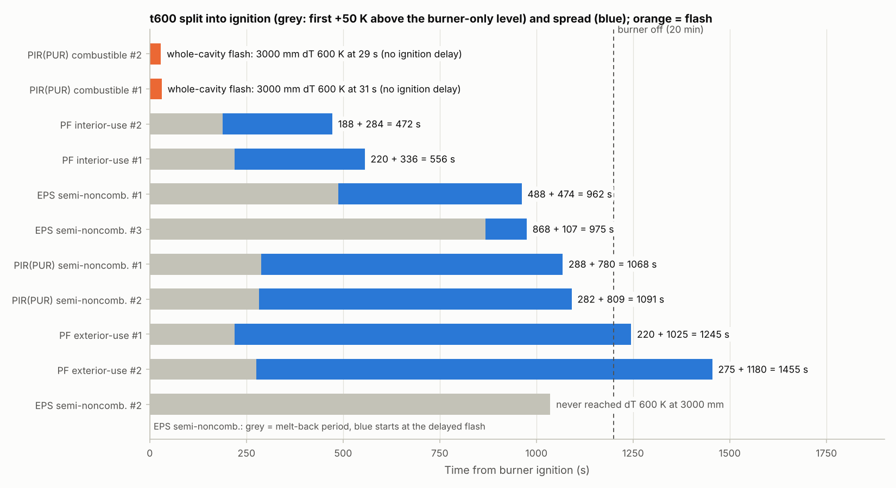
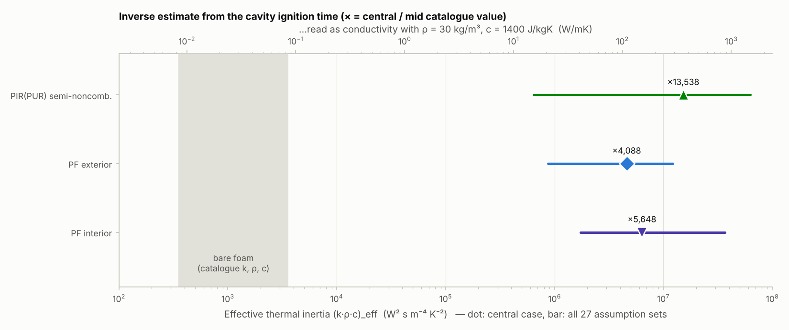
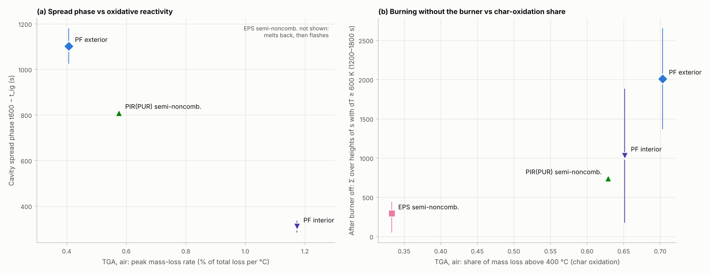
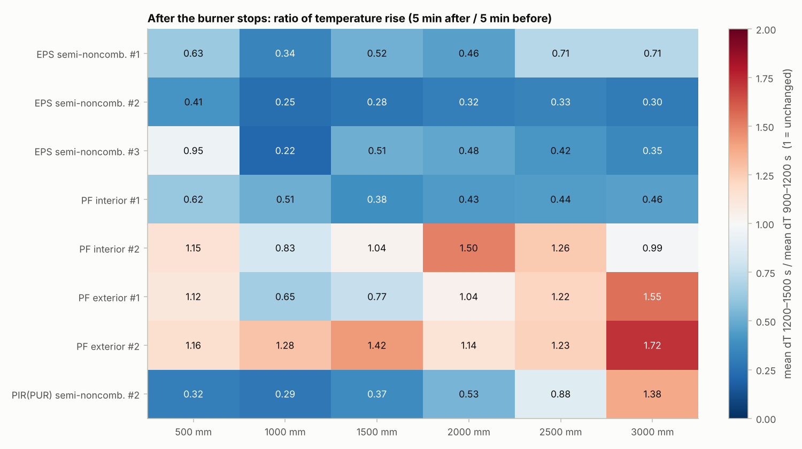

# 중공층 화재시험(30 kW·20분) × TGA–DSC 연계 분석 – 열전도율 역산의 가능성과 대안 지표

대상 시험은 중공층 100 mm·외단열 100 mm 시험체의 중규모 성능평가입니다. 30 kW 가스버너를 20분(0–1200 s) 가동했고, 30분(1800 s)까지 평가했습니다. 이 자료와 [TGA–DSC 분석](../tga_dsc/README.md)을 함께 써서 **열전도율을 계산할 수 있는지** 검토했습니다. 그 결과를 바탕으로 재료별로 의미 있는 비교를 했습니다.

모든 수치·그림은 `python analysis.py`로 재현됩니다(→ [부록](#부록-재현-방법과-산출물)). 그림 안의 글자는 영문입니다.

## 0. 결론 – "TGA–DSC와 중공층 중앙 온도로 열전도율을 계산할 수 있는가?"

**단열재의 열전도율(k) 자체는 이 두 자료로 계산할 수 없습니다.** 다만 같은 계산을 '유효값'으로 해 보면 중요한 사실이 하나 드러납니다. 그 밖에도 의미 있는 결과 세 가지를 얻었습니다.

> PIR(PUR) 가연성·준불연 각 2회를 추가한 판입니다. 가연성 PIR(PUR)은 점화 30 s 만에 중공층 전체가 화염에 잠겨 착화·확산 단계가 따로 없습니다. 아래 결과 중 착화·확산 분해와 역산은 **준불연 재료**에 해당합니다.

1. **열전도율을 직접 구할 수 없는 이유**
   - TGA–DSC는 질량과 열류만 측정합니다. k는 측정 항목이 아닙니다. DSC로 비열(c_p)은 구할 수 있지만, 빈 도가니(blank)와 사파이어 기준 측정이 있어야 합니다. 현재 자료에는 블랭크가 없습니다.
   - 중공층 중앙 열전대는 **공기(가스) 온도**를 잽니다. k를 구하려면 단열재 **두께 방향 온도분포**(표면·내부 열전대)나 **벽면 입사 열유속**이 있어야 합니다.
   - 표면 온도만으로 역산하더라도 k, ρ, c는 따로 구할 수 없습니다. 두꺼운 고체의 표면 가열은 세 값의 곱인 **열관성 kρc**로만 결정되기 때문입니다.
2. **그래도 역산하면 – 착화 지연은 단열재의 열전도율이 결정하지 않습니다(그림 3).**
   - 방법: 1000 mm 측정온도로 단열재 표면을 가열했다고 보고, TGA의 분해 시작온도에 실제 착화 시점에 도달하게 하는 **유효 열관성 (kρc)_eff**를 역산했습니다.
   - 결과: (kρc)_eff = **4.3×10⁶ – 1.5×10⁷ W²s/m⁴K²**입니다. 카탈로그 물성으로 계산한 단열재 값(약 1.1×10³)의 **3,900–13,500배**입니다.
   - 이를 열전도율로 읽으면(ρ = 30 kg/m³, c = 1400 J/kgK 가정) **100–360 W/mK**가 됩니다. 알루미늄(약 200 W/mK) 수준이라 단열재로는 물리적으로 불가능합니다. 가정 27가지 중 가장 작은 값을 ρ·c 카탈로그 최댓값(60 kg/m³, 1500 J/kgK)으로 환산해도 2.9 W/mK로, 카탈로그 상한(0.040 W/mK)의 약 70배입니다.
   - 반대로 카탈로그 물성을 넣으면 단열재 표면은 버너 점화 후 **16–51 s**면 분해온도에 도달합니다. 실제로 준불연 재료가 열을 보태기 시작한 시점은 **188–288 s**입니다.
   - 따라서 착화 지연(약 3–5분)은 단열재 자체의 k·ρ·c가 아니라 **시스템과 준불연 처리**가 결정합니다. 면재, 난연 처리, 화염의 벽면 부착, 열분해가스의 축적·착화가 여기에 들어갑니다. 이 값은 **시스템의 착화 저항(TRP_eff)**으로만 해석해야 합니다.
   - 가연성 PIR(PUR)은 이 지연이 아예 없었습니다(전체 화염까지 30 s). 같은 PIR(PUR)이라도 준불연 처리 여부가 착화 지연 3–5분을 만든다는 직접적인 증거입니다.
   - 재료 간 비교: 가정에 따른 범위가 서로 크게 겹칩니다. 그래서 유효 열관성으로는 재료를 구분할 수 없습니다.
3. **재료 순위는 착화가 아니라 '확산 단계'에서 갈립니다(그림 1·2a).**
   - t₆₀₀(3000 mm에서 ΔT ≥ 600 K 도달시간)을 착화(t_ig)와 확산(t₆₀₀ − t_ig)으로 나눴습니다.
   - 착화 단계는 준불연 PF·PIR(PUR) 모두 **188–288 s**로 비슷합니다(최대 1.5배 차이). 확산 단계는 **284–1180 s**로 4배 이상 차이 납니다.
   - 확산 단계 순서가 TGA **공기 중 최대 질량감소속도(r_max)** 순서와 같습니다.

     | 재료 | TGA 공기 r_max (%/°C) | 확산 단계 (s) |
     |---|---|---|
     | PF 준불연 내부용 | 1.17 | 284–336 |
     | PIR(PUR) 준불연 | 0.58 | 780–809 |
     | PF 준불연 외부용 | 0.41 | 1025–1180 |

   - 재료가 3종이라 통계적 유의성은 없습니다(완전 순위 일치의 정확 p = 0.33).
   - 가연성 PIR(PUR)은 r_max 0.75로 중간이지만 확산 단계 없이 30 s 만에 전체가 탔습니다. 이 관계는 준불연 재료 안에서만 성립합니다.
4. **버너를 끈 뒤의 자립 연소는 준불연 재료에서 TGA의 '탄화층 산화 비율'과 순서가 같습니다(그림 2b·4).**
   - 버너 소화(1200 s) 뒤 5분간 평균 온도상승을 소화 전 5분과 비교했습니다.
   - **PF 준불연 외부용**은 버너가 꺼져도 온도가 유지되거나 오릅니다(비 0.65–1.72). 소화 5–10분 뒤(1500–1800 s)에도 높이별 평균 ΔT 200–1050 K를 유지합니다. 스스로 계속 탑니다.
   - **EPS 준불연**은 0.22–0.95로 바로 감쇠합니다.
   - **PIR(PUR) 준불연**은 하부가 0.2–0.3으로 꺼지는 사이 상부(3000 mm)는 0.96–1.38로 유지·상승합니다. 연소대가 위로 이동한 것이고, 10분 뒤에는 전 높이에서 사그라듭니다.
   - **PIR(PUR) 가연성**은 버너가 꺼지기 전에 이미 연료가 대부분 소진되어 0.12–0.25로 바로 꺼집니다.
   - 소화 후 '각 높이에서 ΔT ≥ 600 K가 유지된 시간의 합' 순서(EPS 준불연 293 < PIR(PUR) 준불연 609 < PF 내부용 1031 < PF 외부용 2011 s, 중앙값)가 TGA 공기 분위기 **f₄₀₀**(400 °C 이상에서 일어난 질량감소 비율) 순서(0.33 < 0.63 < 0.65 < 0.70)와 같습니다.
   - 준불연 4종 완전 일치의 정확 p = 0.083입니다. 일관된 경향이지만 통계적으로 유의하다고 할 수는 없습니다. PF 내부용은 두 시험의 차이가 큽니다(175 vs 1886 s).
   - 가연성 PIR(PUR)(f₄₀₀ 0.67, 소화 후 15 s)은 맞지 않습니다(5종 ρ = 0.4). 버너가 꺼질 때 남은 연료가 없으면 탄화층 산화 비율과 관계없이 꺼지므로, 이 관계는 **소화 시점까지 타고 있던 재료**에만 적용됩니다.
5. **위험평가식에 주는 의미**
   - [평가식](../cavity_fire_index/RISK_MODEL.md)의 TRP는 **카탈로그 k·ρ·c로 계산하면 안 됩니다.** 시스템의 실제 착화 저항보다 두 자릿수 작습니다(TRP_eff/TRP_nominal ≈ 60–120). 콘칼로리미터 착화시간에서 구한 TRP를 써야 합니다.
   - 준불연 재료의 확산속도(t₆₀₀, P 등급의 근거)는 TGA 공기 r_max와 같은 순서입니다. 가연성 등급은 TGA로 예측할 수 없습니다([통합 평가식](../integrated_model/README.md)).
   - 현재 심각도 S는 3000 mm 한 지점의 600 K 유지시간만 봅니다. 그래서 PF 준불연 외부용처럼 **버너 소화 후 전 높이에서 오래 타는** 특성이 S에 반영되지 않습니다(PF 준불연 외부용 S = 2). 소화 후 자립 연소를 보조 지표로 추가하는 것을 검토할 만합니다. 이 지표는 TGA 공기 f₄₀₀와 순서가 같습니다.
   - 두 관계 모두 **TGA 기반 사전 선별 지표**의 가능성을 보여줍니다. 다만 재료 3–4종에서 나온 가설이므로 시험을 추가해 확인해야 합니다.

---

## 1. 대상 시험과 자료

| 재료 (c = 가연성, sc = 준불연성) | 중공층 시험 | 이 분석에서 |
|---|---|---|
| EPS 가연성 (EPS_C) | #1·#2: 기록 0–240 s, 0–262 s뿐(#2는 263 s부터 다른 시험 기록) | 제외: 20분 가열 조건을 담지 못함 |
| EPS 준불연 (EPS_SC) | #1·#2·#3 | 착화·확산 분해, 버너 소화 분석(역산은 제외, 아래 설명) |
| PIR(PUR) 가연성 (PIR_C) | #1·#2 | 전체 화염(flash) 판정, 버너 소화 분석(착화·확산 분해와 역산은 해당 없음) |
| PIR(PUR) 준불연 (PIR_SC) | #1·#2 | 전체 |
| PF 준불연 외부용 (PF_out) | #1·#2(#0은 기록 184 s, 제외) | 전체 |
| PF 준불연 내부용 (PF_in) | #1·#2 | 전체 |

- **시험 조건**: 중공층 100 mm, 외단열 100 mm, 30 kW 가스버너 20분입니다. 1 Hz로 기록했고, 각 높이(500·1000·…·3000 mm)는 열전대 3개 중 최댓값을 씁니다(전처리는 [cavity_fire_index](../cavity_fire_index/README.md)와 같습니다).
- **버너 소화 시점 확인**: EPS 준불연과 PIR(PUR)의 하부 온도가 1170–1203 s에 동시에 급락합니다. PF는 같은 시점에 급락이 없습니다. 버너가 꺼져도 스스로 타고 있었기 때문입니다.
- **전체 화염(flash) 판정**: 3000 mm 600 K 도달이 버너 단독 기준 구간(90–180 s)이 끝나기 전이면, 버너 단독 온도 수준을 정의할 수 없으므로 착화·확산을 나누지 않습니다. PIR(PUR) 가연성 2회(29·31 s)가 해당합니다.
- **PIR 표기**: 요청에 따라 PIR을 PUR과 같은 계열로 보고 'PIR(PUR)'로 표기했습니다.
- **EPS 준불연을 역산에서 뺀 이유**: EPS는 화염을 받으면 녹아서 물러납니다(melt-back). 따라서 '고정된 표면이 가열되어 분해온도에 도달한다'는 모델 가정이 성립하지 않습니다. 실제로 EPS 준불연의 온도는 60–150 s에 최고점을 찍고 떨어졌다가, 488–1036 s에 지연된 순간 연소(flash)가 일어납니다.

## 2. 열전도율을 구하려면 무엇이 필요한가

| 물성 | 표준 측정법 | 현재 자료로 가능한가 |
|---|---|---|
| 열전도율 k | KS L 9016(평판 열류계), 레이저 플래시, 핫디스크 | **불가**: 측정 항목이 아님 |
| 밀도 ρ | 시편 치수·질량 | **불가**: 값 없음 |
| 비열 c_p | DSC – 블랭크 + 사파이어 기준(ASTM E1269) | **불가**: 블랭크가 없음 |
| 분해·산화 온도, 반응 속도 | TGA | **가능**: 임계온도 T_crit로 사용 |
| 시험 중 k(T) | 단열재 두께 방향 열전대 + 벽면 열유속계 | **불가**: 중공층 중앙 공기온도만 있음 |

- 열적으로 두꺼운 고체의 표면 온도는 다음 식을 따릅니다.

  > T_s(t) − T₀ = (1/√(π·kρc)) ∫₀ᵗ q″(τ) / √(t − τ) dτ

- 이 식에는 k, ρ, c가 **kρc라는 곱으로만** 들어갑니다. 그래서 표면이나 공기 온도만으로는 셋 중 어느 것도 따로 구할 수 없습니다. 깊이별 온도가 있으면 열확산계수 α = k/ρc를 구할 수 있습니다. 여기에 밀도와 비열을 알면 k가 나옵니다.

## 3. 방법

### 3.1 착화(이탈) 시점 t_ig

- 1000–3000 mm 각 높이에서 31 s 평활한 ΔT가 **버너 단독 구간(90–180 s) 중앙값보다 +50 K 이상**인 상태로 30 s 유지되기 시작하는 시각을 구합니다. 그중 가장 이른 시각이 t_ig입니다.
- 버너 열만으로 형성된 온도 수준을 넘어 재료가 열을 보태기 시작한 시점이라는 뜻입니다.
- 민감도: +30 K, +80 K로도 계산했습니다(표의 t_ig 범위).

### 3.2 임계 표면온도 T_crit (TGA)

- TGA 공기 분위기 DTG가 처음으로 **총 질량감소의 0.2 %/°C**를 넘는 온도(150 °C 이상)입니다. 반복 2회의 평균을 씁니다.
- 민감도: 0.1, 0.3 %/°C로도 계산했습니다.

| 재료 | 0.1 %/°C | **0.2 %/°C (기준)** | 0.3 %/°C |
|---|---|---|---|
| EPS 준불연 | 224 | **266** | 302 |
| PIR(PUR) 가연성 | 250 | **277** | 287 |
| PIR(PUR) 준불연 | 229 | **278** | 486 |
| PF 준불연 외부용 | 327 | **353** | 381 |
| PF 준불연 내부용 | 247 | **343** | 364 |

### 3.3 역산 모델

- **가열 조건**: 1000 mm 측정온도(11 s 평활)를 단열재 표면이 접하는 가스온도 T_g로 봅니다.
- **표면 열유속**: q″ = h_c(T_g − T_s) + εσ(T_g⁴ − T_s⁴)
- **열전도**: 반무한 고체(두께 100 mm 대비 300 s 침투깊이 약 15 mm)로 보고, 위 적분식을 1 s 간격 Duhamel 중첩으로 계산합니다. 각 단계의 열유속은 새 표면온도로 평가하는 음해법(Newton)이라 작은 열관성에서도 안정합니다. 대류 해석해와의 오차는 10 s 이후 2 K 이하입니다.
- **역산**: T_s(t_ig) = T_crit가 되는 (kρc)_eff를 로그 이분법으로 찾습니다.
- **열전달 가정 3가지**: 낮음(h_c = 10 W/m²K, ε = 0.5), **기준(20, 0.7)**, 높음(30, 0.9)입니다. 이때 버너 점화 후 60–240 s의 차가운 벽 기준 입사 열유속은 24–83 kW/m²(기준 37–62 kW/m²)입니다.
- **조합**: 이탈 기준 3 × T_crit 기준 3 × 열전달 3 = 시험당 27가지입니다. 모든 조합에서 해가 존재했습니다.
- **파생값**
  - TRP_eff = (T_crit − T₀)·√(π·(kρc)_eff / 4)
  - k_app = (kρc)_eff / (ρ·c), ρ = 30 kg/m³, c = 1400 J/kgK를 가정한 **설명용** 값입니다.

## 4. 결과

### 4.1 착화 단계와 확산 단계



| 시험 | t_ig (s) [+30–80 K] | t₆₀₀ (s) | 확산 단계 (s) | 1000 mm 평균온도 0–t_ig (°C) |
|---|---|---|---|---|
| PIR(PUR) 가연성 #1·#2 | 전체 화염 | 31 · 29 | – | – |
| PF 준불연 내부용 #1 | 220 [171–232] | 556 | 336 | 683 |
| PF 준불연 내부용 #2 | 188 [163–222] | 472 | 284 | 670 |
| PIR(PUR) 준불연 #1 | 288 [271–301] | 1068 | 780 | 577 |
| PIR(PUR) 준불연 #2 | 282 [168–346] | 1091 | 809 | 693 |
| PF 준불연 외부용 #1 | 220 [171–246] | 1245 | 1025 | 599 |
| PF 준불연 외부용 #2 | 275 [175–287] | 1455 | 1180 | 644 |
| EPS 준불연 #1 | 488 [356–935] | 962 | 474 | 676 |
| EPS 준불연 #2 | 1036 [1032–1042] | 미도달 | – | 710 |
| EPS 준불연 #3 | 868 [721–961] | 975 | 107 | 829 |

- 준불연 PF와 PIR(PUR)은 모두 버너 점화 후 3–5분에 재료가 타기 시작합니다. 착화 시점만으로는 재료를 구분하기 어렵습니다.
- 차이는 그 뒤 화염이 3000 mm까지 올라가는 데 걸리는 시간에서 납니다. PF 내부용은 약 5분, PIR(PUR) 준불연은 약 13분, PF 외부용은 17–20분입니다.
- 가연성 PIR(PUR)은 점화 15–25 s에 500–3000 mm가 동시에 ΔT 500 K를 넘습니다(그림 1의 주황 막대).
- EPS 준불연의 t_ig는 '착화'가 아니라 녹아서 물러난 뒤의 **지연된 순간 연소** 시점입니다. 그 뒤 3000 mm까지 107–474 s 만에 도달하거나(#1·#3), 도달하지 않습니다(#2). 다른 재료와 같은 축으로 비교하지 않았습니다.

### 4.2 역산 유효 열관성



| 시험 | (kρc)_eff 기준 (W²s/m⁴K²) | 27가지 범위 | 카탈로그 대비 | TRP_eff (kW·s^½/m²) | k_app (W/mK, 설명용) |
|---|---|---|---|---|---|
| PF 준불연 내부용 #1 | 6.8×10⁶ | 1.8×10⁶ – 3.4×10⁷ | ×6,100 | 694 | 162 |
| PF 준불연 내부용 #2 | 5.9×10⁶ | 1.7×10⁶ – 3.7×10⁷ | ×5,200 | 646 | 140 |
| PIR(PUR) 준불연 #1 | 6.3×10⁶ | 2.6×10⁵ – 2.3×10⁷ | ×5,600 | 511 | 149 |
| PIR(PUR) 준불연 #2 | 1.5×10⁷ | 6.4×10⁵ – 6.2×10⁷ | ×13,500 | 874 | 362 |
| PF 준불연 외부용 #1 | 4.3×10⁶ | 9.1×10⁵ – 1.2×10⁷ | ×3,900 | 598 | 103 |
| PF 준불연 외부용 #2 | 4.8×10⁶ | 8.7×10⁵ – 1.2×10⁷ | ×4,300 | 629 | 115 |

- 카탈로그 범위: k 0.018–0.040 W/mK, ρ 15–60 kg/m³, c 1300–1500 J/kgK에서 kρc = 351–3600입니다. 기하평균 1,124를 기준으로 비교했습니다.
- **해석**
  - 착화까지 3–5분이 걸린 것을 단열재 표면의 열전도로 설명하려면, 단열재가 금속처럼 열을 빨아들여야 합니다. 실제로는 그렇지 않으므로 **지연의 원인은 다른 데 있습니다.**
  - 가능한 원인: 면재(알루미늄박 등)의 반사·차단, 화염이 벽면에 붙기 전까지의 낮은 실제 열전달, 분해가스가 연소 가능한 농도까지 쌓이는 시간, 그리고 '+50 K' 판정이 '분해 시작'보다 늦은 '열 기여 시작'을 잡는다는 점.
  - 이 역산값은 이 요인을 모두 묶은 **시스템의 착화 저항**입니다. 단열재 물성이 아닙니다.
- **재료 간 비교**: 기준값은 PIR(PUR) 준불연 #2가 가장 높지만, 같은 재료 #1은 2.4배 낮습니다. 가정에 따른 범위도 재료마다 1–2 자릿수에 걸쳐 서로 겹칩니다. 그래서 이 값으로 준불연 재료의 순위를 매기는 것은 근거가 약합니다.
- **가연성과 준불연의 차이**: 가연성 PIR(PUR)은 착화 지연이 없으므로 역산값이 정의되지 않습니다. 굳이 표현하면 실효 착화 저항이 단열재 물성 수준(×1)에 가깝다는 뜻이고, 준불연 처리가 이를 수천 배로 키운 셈입니다.

### 4.3 TGA와의 연결



- **(a) 확산 단계 vs 공기 중 최대 질량감소속도**
  - 공기 중에서 빨리 분해·산화하는 재료일수록 화염이 위로 빨리 올라갑니다.
  - TGA 분석에서 이미 준불연 재료의 t₆₀₀과 r_max의 순서가 같다는 것을 확인했습니다. 이번 분석으로 그 연결이 **착화가 아니라 확산 단계**에서 생긴다는 것을 알 수 있습니다. 착화 단계는 재료 간에 거의 같기 때문입니다.
- **(b) 소화 후 자립 연소 vs 탄화층 산화 비율**
  - f₄₀₀이 클수록 400 °C 이상에서 탄화층이 산소와 반응하며 타는 몫이 큽니다.
  - 이런 재료일수록 버너가 꺼진 뒤에도 고온이 오래 유지됩니다.
  - 페놀폼은 탄화층이 불꽃 없이 붉게 타들어가는 경향이 있는 것과 맞는 결과입니다. 이번 시험에서 PF 외부용은 버너 소화 5–10분 뒤에도 500 mm의 평균 ΔT가 550–1050 K였습니다.
  - 가연성 PIR(PUR)은 버너가 꺼지기 전에 연료가 소진되어 이 관계에서 벗어납니다(그림 2b 오른쪽 아래).

### 4.4 버너 소화 후 거동



평균 ΔT (K): 소화 전 5분(900–1200 s) → 소화 후 5분(1200–1500 s) → 소화 후 5–10분(1500–1800 s)

| 시험 | 500 mm | 1500 mm | 3000 mm | 소화 후 ΔT ≥ 600 K 시간 합 (s) |
|---|---|---|---|---|
| PF 준불연 외부용 #1 | 934 → 1042 → 550 | 898 → 694 → 218 | 412 → 639 → 208 | 1370 |
| PF 준불연 외부용 #2 | 954 → 1104 → 1047 | 714 → 1016 → 647 | 240 → 414 → 756 | 2652 |
| PF 준불연 내부용 #1 | 816 → 508 → 154 | 850 → 327 → 146 | 894 → 410 → 221 | 175 |
| PF 준불연 내부용 #2 | 948 → 1088 → 577 | 871 → 903 → 341 | 857 → 845 → 308 | 1886 |
| PIR(PUR) 준불연 #1 | 632 → 154 → 27 | 903 → 463 → 78 | 608 → 585 → 154 | 476 |
| PIR(PUR) 준불연 #2 | 842 → 269 → 37 | 814 → 300 → 42 | 602 → 832 → 244 | 741 |
| PIR(PUR) 가연성 #1 | 855 → 200 → 45 | 543 → 102 → 36 | 281 → 71 → 36 | 24 |
| PIR(PUR) 가연성 #2 | 777 → 169 → 49 | 576 → 84 → 32 | 478 → 82 → 36 | 6 |
| EPS 준불연 #1 | 840 → 530 → 670 | 838 → 433 → 99 | 495 → 352 → 53 | 440 |
| EPS 준불연 #2 | 812 → 333 → 52 | 538 → 149 → 27 | 263 → 79 → 24 | 50 |
| EPS 준불연 #3 | 692 → 658 → 377 | 641 → 328 → 62 | 397 → 141 → 50 | 293 |

- **PF 준불연 외부용**: 소화 후 오히려 온도가 오르는 높이가 많습니다(비 > 1). 시험 종료(30분)까지 넓은 높이에서 고온이 이어집니다. 확산은 가장 느리지만 **한번 타면 오래 탑니다**. 평가식에서는 P = 2, S = 2(3000 mm 기준)로 '보통'인데, 이 지속 연소는 S에 들어가지 않습니다.
- **PF 준불연 내부용**: #2는 외부용과 비슷하게 자립 연소합니다. #1은 소화 후 빠르게 감쇠했습니다(비 0.38–0.62). #1은 556 s에 이미 3000 mm에 도달해 연소가 일찍 진행됐으므로, 소화 시점에 남은 연료가 적었을 수 있습니다.
- **PIR(PUR) 준불연**: 하부는 소화 직후 급락합니다. 소화 전 5분 동안 3000 mm만 상대적으로 낮았다가(602–608 K) 소화 후 585–832 K로 유지·상승했습니다. 연소대가 위로 이동한 뒤 전체가 사그라든 것입니다.
- **PIR(PUR) 가연성**: 소화 전 5분에 이미 상부(1500–3000 mm)가 281–576 K로 내려와 있습니다. 15분 전후에 상부부터 다 타버렸고, 버너가 꺼지자 전 높이가 바로 식었습니다. '빨리, 크게 타고 일찍 끝나는' 거동입니다.
- **EPS 준불연**: 모든 높이에서 감쇠합니다. 500 mm(#1·#3)만 고온이 남는데, 녹은 EPS가 하부에 모여 타는 것으로 보입니다.

## 5. 한계

- **표본 수**: 재료당 2–3회이고, 준불연 탄화형 재료는 3종뿐입니다. 상관관계는 경향으로만 읽어야 합니다.
- **가열 조건**: 공기온도(중공층 중앙)를 벽면 가스온도로 썼고, 열전달계수는 가정값입니다. 범위로 반영했지만 실제 벽면 열유속은 측정되지 않았습니다.
- **TGA 승온속도**: TGA는 5 °C/min이고, 화재 중 표면은 분당 수백 °C로 가열됩니다. 승온속도가 빠르면 분해온도가 수십 °C 높아집니다. T_crit 기준을 바꾼 민감도(0.1–0.3 %/°C)로 일부만 반영했습니다.
- **산화 분위기**: TGA의 'O' 분위기가 공기인지 순수 산소인지 확인되지 않았습니다.
- **역산값의 의미**: (kρc)_eff, TRP_eff, k_app는 착화 지연을 재현하는 '시스템 값'입니다. 단열재의 물성으로 쓰면 안 됩니다.

## 6. 열전도율까지 구하려면 – 추가 측정 권고

| 우선순위 | 항목 | 얻는 것 |
|---|---|---|
| 1 | 단열재 **표면·내부 열전대**(예: 표면, 깊이 10·25·50 mm), 1000 mm와 2000 mm 높이 | 시험 중 열확산계수 α(T) 역산 → 밀도·비열과 합쳐 k(T) |
| 1 | **벽면 열유속계**(Schmidt-Boelter 또는 Gardon), 같은 높이 | 실제 입사 열유속 → 3.3의 열전달 가정 제거 |
| 2 | 재료별 **밀도**, **KS L 9016 열전도율**(상온·고온) | 카탈로그 대비 실제 k·ρ, TRP_nominal |
| 2 | **DSC 블랭크 + 사파이어** 측정 | 비열 c_p(T), 분해 엔탈피(J/g) |
| 2 | **콘칼로리미터** 3–4개 열유속의 착화시간·열방출률 | TRP·Q″ → 위험평가식의 재료지수 M |
| 3 | TGA **시료 초기 질량**, 'O' 분위기 가스 종류 | 잔류율(%), 산화 조건 확정 |
| 3 | 버너 가스유량 기록 또는 산소소비 열방출률 | 재료 기여 열방출률 분리 |
| 3 | EPS 가연성 시험의 **전체 기록**(현재 0–240 s, 0–262 s) | 가연성–준불연성 EPS 비교 |

---

## 부록: 재현 방법과 산출물

```bash
# 필요: ../cavity_fire_index/data/{EPS,PF,PIR}.xlsx, ../tga_dsc/data/{N,O}/*.csv
#       ../tga_dsc/results/tga_summary.csv (tga_dsc/analysis.py 실행 결과)
python analysis.py
```

| 파일 | 내용 |
|---|---|
| `results/ignition_spread_inverse.csv` | 시험별 전체 화염 여부, t_ig, t₆₀₀, 확산 단계, T_crit, (kρc)_eff(기준·최소·최대), TRP_eff, k_app |
| `results/inverse_sensitivity.csv` | 시험별 27가지 가정 조합의 역산값 |
| `results/burner_off.csv` | 시험·높이별 소화 전후 평균 ΔT, 비, ΔT ≥ 600 K 유지시간 |
| `results/material_summary.csv` | 재료별 요약과 TGA 지표(r_max, f₄₀₀, T_α90) |
| `figures/fig1_ignition_spread.png` | t₆₀₀의 착화·확산 분해 |
| `figures/fig2_tga_links.png` | 확산 단계–r_max, 소화 후 지속–f₄₀₀ |
| `figures/fig3_inverse_inertia.png` | 역산 유효 열관성과 카탈로그 범위 |
| `figures/fig4_burner_off.png` | 소화 후/전 온도상승 비 히트맵 |

- 중공층 자료의 전처리(결측·이상 열전대 처리, 평활, 도달시간 정의)는 `../cavity_fire_index/analysis.py`를, TGA 처리는 `../tga_dsc/analysis.py`를 그대로 불러 씁니다.
- 원본 데이터(xlsx, csv)는 저장소에 올리지 않습니다(`.gitignore`).
