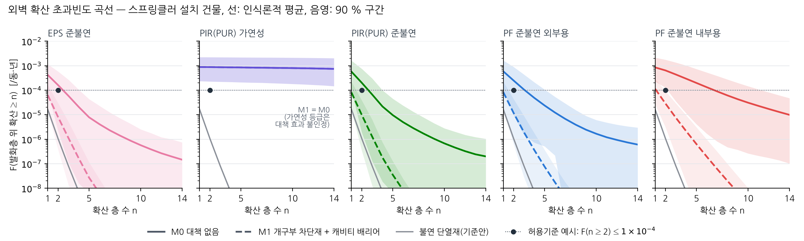
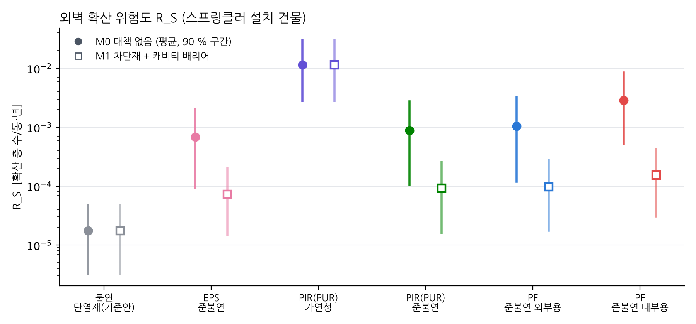
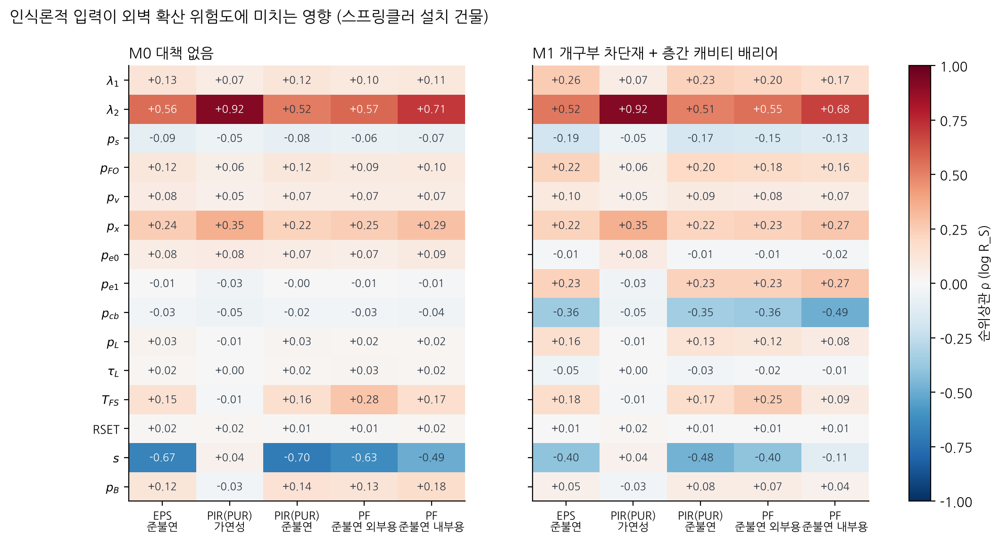

# 외벽 정량적 화재위험성평가 – NFPA 551 5.5 절차와 중공층 시험 예제

NFPA 551(2022, *Guide for the Evaluation of Fire Risk Assessments*)의 정량적 방법을 외벽(중공층 외단열)에 적용하는 절차, 계산 모델, 보고서 서술 방법을 정리했습니다. 중공층 시험 자료로 예제를 끝까지 계산했습니다.

| 파일 | 용도 |
|---|---|
| [`report/외벽_정량적_화재위험성평가_절차.pptx`](report/외벽_정량적_화재위험성평가_절차.pptx) | 절차 설명 23쪽: NFPA 551·EFFECT에서 가져올 것, 12단계, 사건수목·확산 모델, 예제 결과, 불확실성·검증, 문서화·검토 |
| [`report/외벽_QFRA_계산서.xlsx`](report/외벽_QFRA_계산서.xlsx) | 점추정을 셀 수식으로 계산(노란 칸을 바꾸면 다시 계산). 사건수목 → 결과 → 위험도 → 판정, MC 결과, 검증, NFPA 551 문서화 점검표 |
| [`report/외벽_QFRA_서술양식.docx`](report/외벽_QFRA_서술양식.docx) | NFPA 551 7장(개념보고서 7.2, 정량 결과 7.3.3.4, 유지관리 7.4, 검토 8장) 항목별 쓸 내용 · 작성 방법 · 예문 |

모든 수치·그림은 `python qfra.py`로 재현됩니다(→ [부록](#부록-재현-방법과-산출물)). 원자료(시험 엑셀)는 필요 없고, 앞선 분석의 결과 CSV만 씁니다.

> **예시 입력 주의**: 빈도·분기확률·시간은 절차를 보이기 위한 예시값입니다. 측정값은 중공층 시험의 t₆₀₀(3000 mm)과 플래그 B(버너 소화 후 자립 연소)뿐입니다. 결론으로 쓰기 전에 국내 통계·실대형 시험값으로 바꾸십시오(`inputs/parameters.csv`의 `basis` 열에 대체할 자료를 적었습니다).

## 0. 결론

1. **NFPA 551은 방법을 정하지 않습니다.** 관할기관이 화재위험성평가를 검토할 때 쓰는 지침이라(1.1), "방법을 강제하지 않고 검토 절차와 문서를 기술한다"고 적혀 있습니다(1.2). 정량법에 대해서는 요건만 줍니다: R = Σ C_i F_i(식 5.5.1.2), 시나리오 군집(5.5.1.4), 불확실성(4.5, 5.5.6), 문서(7.3.3.4), 검토(8.2·8.3). 외벽용 시나리오·분기 구조·결과 모델·기준값은 평가자가 채워야 합니다.
2. **외벽 정량 평가 = 사건수목(빈도) × 층간 확산 모델(결과).**
   - 빈도: IE1 세대 화재 → 창 분출화염, IE2 외부 발화원(필로티·차량·쓰레기) → 외벽 하부.
   - 결과: 발화층 위로 번지는 층 수 n과, 피난 전에 화염이 닿는 재실자 수.
   - 재료 입력: 중공층 t₆₀₀ = '중공층 화재가 한 층(3 m)을 오르는 시간'(앞서 제안한 FRI와 같은 생각), 플래그 B = 자립 연소.
3. **기존 R = P × S의 위치**: P(확산 등급)와 S(고온 지속)는 둘 다 결과 쪽 지표이므로 NFPA 551 표 5.1.2.1로는 위험 지수(정성 범주)에 해당합니다. 정량법은 여기에 빈도 F를 더합니다(위험 = 확률과 결과의 쌍, 3.3.14).
4. **예제 결과**(15층 공동주택, 스프링클러 설치, 예시 입력)
   - 예시 기준 F(n ≥ 2) ≤ 1×10⁻⁴/동·년, 신뢰수준 90 %
   - 대책 없음: PIR(PUR) 가연성·PF 내부용은 '불충족', 다른 준불연 3종은 '판단 유보'
   - 개구부 차단재 + 층간 배리어: 준불연 4종 모두 '충족'(96 % 이상)
   - 가연성 등급은 배리어 효과를 입증하는 시험이 없어 대책 효과를 인정하지 않았습니다.
5. **판정을 바꾸는 자료**(민감도 순): ① s(3 m 시험 → 실물 층당 시간): 실대형 시험(KS F 8414) ② λ₂·p_x(외부 발화원 빈도): 화재 통계 ③ p_cb·p_e1(배리어·차단재 효과): 배리어를 넣은 중공층 시험.
6. **EFFECT**: 사용자 가이드 원문은 이번에 받지 못했습니다(업로드 폴더에 없음, 환경 네트워크 정책상 nfpa.org 접속 불가). 공개 발표 기준으로 Tier 1·2 구성과 요인(외장·단열재 가연성, 발화원, 건물 특성, 방화설비)을 정량 입력에 대응시켰습니다. 원문을 받으면 문항·가중치 단위로 갱신합니다.

## 1. NFPA 551이 주는 것과 비어 있는 것

| 요소 | NFPA 551이 주는 것 | 외벽에서 비어 있던 것 → 이 자료에서 채운 것 |
|---|---|---|
| 위험의 정의 | R_t = Σ C_i F_i, 결과가 여럿이면 Σ Σ C_ij F_i (5.5.1.2·5.5.1.3) | 결과 지표 → 확산 층 수 n, 노출 인원, (선택) 사망 |
| 시나리오 | 대표 군집, 제외 근거 (5.1.1.5, 5.5.1.1, 7.2.2.6) | 외벽 초기사건 IE1·IE2 (EFFECT 발화원 항목) |
| 빈도 | 사건수목, 경로 확률 = 분기 확률의 곱 (5.3) | 분기 구조와 예시값 + 대체할 통계 |
| 결과 | 화재 모델, 적용 한계, 검증 (5.4) | 층간 확산 모델(t₆₀₀ = 층당 시간, 진압·배리어·도약과 경쟁) |
| 허용기준 | 지표 형태, 사전협의에서 결정 (4.4.3, A.5.1.2) | 예시 기준값과 신뢰수준 판정 규칙 |
| 불확실성 | 우연적·인식론적 구분과 전파 (4.5, A.5.5.6) | 2중 몬테카를로 + 순위상관 민감도 |
| 문서·검토 | 7.2, 7.3.3.4, 7.4, 8.2, 8.3 | 서술양식.docx, 계산서 8_문서화점검 |

## 2. 12단계 절차

| 단계 | 내용 | NFPA 551 | 산출물 |
|---|---|---|---|
| 1 | 사전협의 · 문제 정의 | 4.3, 4.4.1 | 목적·대상·범위 |
| 2 | 위험요소 정의 | 4.4.2 | 노출 대상·자극·전달·반응 |
| 3 | 허용기준 설정 | 4.4.3, A.5.1.2 | 지표·기준값·신뢰수준 |
| 4 | 방법 선정 | 4.4.4, 5.1.3, 표 5.1.2.1 | 방법·적합성 근거 |
| 5 | 시나리오 선정·군집 | 5.1.1.5, 5.5.1.1 | 초기사건·군집·제외 근거 |
| 6 | 빈도 분석 | 5.3 | 사건수목, 경로별 F |
| 7 | 결과 분석 | 5.4, 5.4.9 | 층간 확산 C |
| 8 | 위험도 산정 | 5.5.1 | R = Σ F·C, 초과빈도 F(n) |
| 9 | 불확실성 분석 | 4.5, 5.5.6 | 분포·신뢰수준·민감도 |
| 10 | 검증·확인 | 5.5.9, 8.2 | 재현 계산·시험 비교 |
| 11 | 문서화 | 7.2, 7.3.3.4, 7.4 | 개념보고서·결과 문서·유지관리 매뉴얼 |
| 12 | 검토·승인 | 8.1, 8.3 | 검토 질문 9개 대응 |

## 3. 모델

**사건수목 (건물 1동, 1년)**
- F₁ = λ₁ · 세대 수 · (1 − p_s) · p_FO · p_v (세대 화재가 창으로 분출)
- F₂ = λ₂ · p_x (외부 발화원이 외벽 노출)
- 중공층·단열재가 노출될 확률 p_e: 차단재가 없으면 p_e0, 불연 차단재가 있으면 p_e1(준불연만 인정)

**층간 확산 모델 (외벽 노출 1회당, 층은 발화층 위로 j = 1 … N − 1)**
- τ_F = s · t₆₀₀ · h / 3 m: 층당 확산시간. s는 시험 → 실물 보정 계수로, 0.25–1을 가정합니다.
- n_F = ⌊min(T_FS, T_stop) / τ_F⌋: 중공층 경로가 오르는 층 수. 자립 연소(플래그 B, 확률 p_B)이면 T_stop = ∞, 아니면 분출 지속시간입니다.
- a_j = (1 − p_cb)^j (j ≤ n_F): 층간 배리어가 층 경계마다 독립으로 막습니다.
- b_j = p_L^j (j ≤ n_L), n_L = ⌊T_FS / τ_L⌋: 창→창 도약(IE1만).
- P(n ≥ j) = w_j [1 − (1 − a_j)(1 − b_j)]: w_j = (N − j)/N(IE1, 발화층 균등) 또는 1(IE2).
- 노출: 층 j에 먼저 닿은 경로의 도달시각 < RSET이면 그 층의 재실자(확산 띠 2세대 × 2.5명)가 노출된 것으로 셉니다.
- 위험도: R_S = F₁ [p_e C₁ + (1 − p_e) C_L] + F₂ p_e C₂. 노출 인원 R_P와 초과빈도 F(n)도 같은 식입니다.

**불확실성 (2중 몬테카를로)**
- 바깥 루프(인식론적) 2,000: 빈도, 분기확률, s, T_FS·RSET·τ_L의 중앙값, p_B ~ Beta(k + ½, n − k + ½)
- 안쪽 루프(우연적) 400(라틴 하이퍼큐브): 진압·피난·도약 시각, 분출 지속시간. 반복시험과 B 상태는 정확히 가중합니다.
- 모든 재료가 같은 난수를 씁니다(재료 간 비교가 정밀함).

## 4. 시험 자료 → 입력 (`inputs/test_inputs.csv`)

| 재료 | t₆₀₀ 3000 mm (s) | 플래그 B k/n → p_B | 외벽 노출 1회당 확산 층 수 (IE1, 대책 없음 / 있음) |
|---|---|---|---|
| EPS 준불연 | 962 / 미도달 / 975 | 0/3 → 0.125 | 0.67 / 0.30 |
| PIR(PUR) 가연성 | 31 / 29 | 0/2 → 0.167 | 7.00 / 인정 안 함 |
| PIR(PUR) 준불연 | 1068 / 1091 | 0/2 → 0.167 | 0.93 / 0.38 |
| PF 준불연 외부용 | 1245 / 1455 | 2/2 → 0.833 | 0.93 / 0.38 |
| PF 준불연 내부용 | 556 / 472 | 1/2 → 0.500 | 2.60 / 0.48 |
| 불연 단열재(기준안) | 중공층 경로 없음 | – | 0.14 (창→창 도약만) |

EPS 가연성은 시험 기록이 4분(240·262 s)뿐이라 t₆₀₀을 구할 수 없어 제외했습니다(자료 부족, 6.2.1.3).

## 5. 예제 결과 (스프링클러 설치 건물, `results/`)

| 재료 | 대책 | R_S 점추정 | R_S MC 평균 [90 %] | F(n ≥ 2) MC 평균 | 기준 충족 비율 | 판정 |
|---|---|---|---|---|---|---|
| 불연 단열재(기준안) | – | 1.8×10⁻⁵ | 1.8×10⁻⁵ [3.2×10⁻⁶–4.7×10⁻⁵] | 1.1×10⁻⁶ | 100 % | 충족 |
| EPS 준불연 | M0 / M1 | 4.4×10⁻⁴ / 6.0×10⁻⁵ | 6.8×10⁻⁴ / 7.3×10⁻⁵ | 1.6×10⁻⁴ / 8.1×10⁻⁶ | 55 % / 99.8 % | 판단 유보 / 충족 |
| PIR(PUR) 가연성 | M0 = M1 | 8.4×10⁻³ | 1.1×10⁻² [2.8×10⁻³–3.0×10⁻²] | 8.8×10⁻⁴ | 0.1 % | 불충족 |
| PIR(PUR) 준불연 | M0 / M1 | 6.5×10⁻⁴ / 8.1×10⁻⁵ | 8.8×10⁻⁴ / 9.2×10⁻⁵ | 2.0×10⁻⁴ / 9.8×10⁻⁶ | 52 % / 99.4 % | 판단 유보 / 충족 |
| PF 준불연 외부용 | M0 / M1 | 6.5×10⁻⁴ / 8.1×10⁻⁵ | 1.0×10⁻³ / 9.7×10⁻⁵ | 2.5×10⁻⁴ / 1.2×10⁻⁵ | 41 % / 99.2 % | 판단 유보 / 충족 |
| PF 준불연 내부용 | M0 / M1 | 1.8×10⁻³ / 1.0×10⁻⁴ | 2.8×10⁻³ / 1.5×10⁻⁴ | 6.4×10⁻⁴ / 2.9×10⁻⁵ | 2 % / 95.7 % | 불충족 / 충족 |

- 단위: R_S = 발화층 위 확산 층 수/동·년, F = /동·년.
- M0 = 대책 없음, M1 = 개구부 불연 차단재 + 층간 캐비티 배리어.
- 판정 기준: 인식론적 표본 가운데 F(n ≥ 2) ≤ 1×10⁻⁴인 비율이 90 % 이상이면 충족, 10 % 이하이면 불충족입니다.
- 순위는 기존 R = P × S와 같은 방향입니다.
- PF 외부용은 자립 연소(B 2/2) 때문에 진압이 늦은 사건에서 계속 올라갑니다. 그래서 MC 평균이 PIR(PUR) 준불연보다 크지만, 중앙값만 넣은 점추정에서는 둘이 같습니다.
- 대책이 없을 때 위험의 82–90 %가 외부 발화원(IE2)에서 옵니다. 세대 스프링클러는 IE1만 줄이기 때문입니다.





## 6. 불확실성 · 민감도



- 대책이 없을 때 log R_S와 상관이 큰 입력:
  - s: ρ = −0.49 ~ −0.70 (준불연)
  - λ₂: +0.52 ~ +0.92
  - p_x: +0.22 ~ +0.35
  - T_FS: PF 외부용 +0.28
- 대책을 넣으면 배리어 효과 p_cb(−0.35 ~ −0.49)와 차단재 효과 p_e1(+0.23 ~ +0.27)이 커집니다.
- 결과 파일: `results/sensitivity_rank.csv`(순위상관), `results/tornado.csv`(한 입력씩 범위 끝값으로 바꾼 점추정).

## 7. 검증 (NFPA 551 8.2.1)

- 엑셀 수식 3,986개와 파이썬을 따로 구현했습니다. 점추정 24경우 × 5지표(120개 값)의 최대 상대차는 3.7×10⁻¹³입니다(`results/verification.csv`, 계산서 7_검증).
- 몬테카를로의 우연적 변동을 0으로 두면 결과가 점추정과 같습니다(qfra.py의 assert).
- 안쪽 표본 1,000개(무작위)와 400개(LHS)의 R_S 평균 차이는 1.5 % 이내입니다.
- **확인(validation)은 남았습니다.** 3 m 시험을 '1개 층'으로 보고 층마다 같은 시간으로 외삽한 부분은 실대형 시험(KS F 8414)이나 PyroSim(FDS) 계산과 비교해야 합니다.

## 8. 한계

1. 3 m 중규모 시험 → 1개 층 외삽, 층마다 같은 τ_F(s = 0.25–1 가정)
2. 빈도·분기확률·시간은 예시값(국내 통계 미반영)
3. 분기 독립 가정, 수평 확산·바람·낙하물 미고려
4. 노출 = 피난 완료 전 화염 도달(연기 영향 제외), 사망 환산 p_d는 가정
5. 반복시험 2–3회, EPS 가연성 자료 없음

## 부록: 재현 방법과 산출물

```bash
pip install -r requirements.txt
python qfra.py                                   # inputs/, results/, figures/, report/qfra_data.json (약 1분)
python report/build_qfra_xlsx.py                 # 계산서
python <xlsx skill>/scripts/recalc.py report/외벽_QFRA_계산서.xlsx   # 수식 값 계산(LibreOffice)
python report/check_xlsx.py                      # 엑셀 = 파이썬 확인 → results/verification.csv, report/verification.json
NODE_PATH=<pptxgenjs가 있는 폴더> node report/build_qfra_deck.js     # PPT (공용 틀: ../tga_dsc/report/deck_lib.js)
node report/build_qfra_docx.js                   # 서술 양식 (npm docx)
```

| 파일 | 내용 |
|---|---|
| `inputs/parameters.csv` | 입력값·범위·분포·NFPA 551 조항·근거(대체할 자료) |
| `inputs/test_inputs.csv` | 시험별 t₆₀₀(3000 mm)·플래그 B·사용 여부 (cavity_fire_index, integrated_model 결과에서) |
| `results/point_estimate.csv` | 점추정: 재료 × 건물(B1/B0) × 대책(M0/M1)의 F, R_S, R_P, IR, F(n), RR_S |
| `results/conditional_consequence.csv` | 외벽 노출 1회당 결과 (재료 × IE × 배리어) |
| `results/mc_summary.csv` | MC 평균·분위수, 기준 충족 비율, 판정 |
| `results/exceedance.csv` | 초과빈도 F(n) 점추정·평균·분위수 |
| `results/sensitivity_rank.csv`, `results/tornado.csv` | 민감도 |
| `results/verification.csv` | 엑셀 계산서와 파이썬의 비교 |
