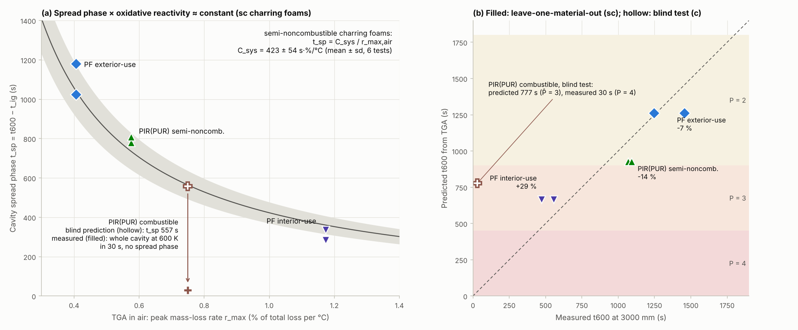
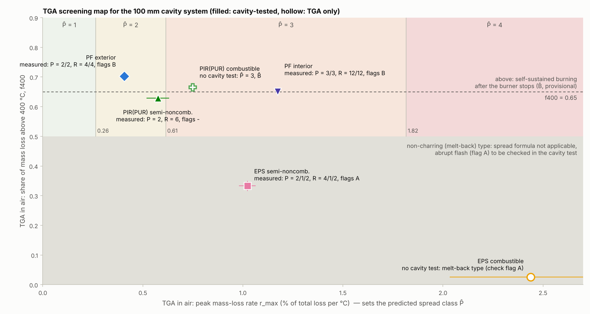

# 중공층 외단열 화재위험 통합 해석·평가식 – 중규모 시험 + TGA

지금 가진 자료만으로 화재 진행을 해석하고, 독자적인 분석식과 위험성 평가 절차를 도출했습니다.
- **중규모 중공층 시험**: 중공층 100 mm, 외단열 100 mm, 30 kW 가스버너 20분, 30분 평가
- **TGA–DSC**: 질소·산화 분위기, 5 °C/min

[중공층 지수](../cavity_fire_index/README.md), [TGA–DSC](../tga_dsc/README.md), [연계 분석](../coupled_analysis/README.md)의 결과를 하나의 체계로 묶은 최종 정리입니다. 모든 수치·그림은 `python analysis.py`로 재현됩니다(→ [부록](#부록-재현-방법과-산출물)). 원자료는 필요 없습니다. 그림 안의 글자는 영문입니다.

> **개정**: PIR(PUR) 가연성·준불연 중공층 시험(각 2회)을 받아 다시 계산했습니다. 이전 판(커밋 `81ea74e`)에서 시험 전에 낸 **가연성 PIR(PUR) 예측이 크게 틀렸습니다**(예측 t₆₀₀ 777 s → 실측 30 s). 그래서 TGA 예측식의 적용 범위를 **준불연 등급**으로 좁히고, 평가 절차 맨 앞에 **등급(가연/준불연) 확인 단계**를 넣었습니다.

## 0. 결론 – "이 자료로 유의미한 해석, 독자 분석식, 위험성 평가식을 도출할 수 있는가?"

**할 수 있습니다. 다만 TGA로 설명되는 범위는 준불연 재료까지입니다.** 탄화형 준불연 재료는 3종(시험 6회)이므로, 계수는 '현재 자료로 보정한 값'이고 추가 시험으로 검증해야 합니다.

1. **해석 – 중공층 화재는 두 영역으로 나뉩니다.**
   - **가연성 등급(PIR(PUR) 가연성)**: 착화 지연이 없습니다. 점화 15–25 s에 500–3000 mm가 동시에 화염에 잠기고(t₆₀₀ 29–31 s, R = 16), 15분 전후에 연료가 소진됩니다.
   - **준불연 등급**: 네 가지 메커니즘으로 설명됩니다.
     - **착화**는 재료가 아니라 시스템·준불연 처리가 정합니다(PF·PIR(PUR) 모두 188–288 s).
     - **확산**은 공기 중 분해속도가 정합니다.
     - **버너 소화 후 지속**은 탄화층 산화가 정합니다.
     - **EPS**는 녹아서 물러났다가 순간적으로 연소합니다.
2. **독자 분석식 – TGA 한 번으로 준불연 재료의 중규모 확산시간을 예측하는 식**
   - **t_sp × r_max,air ≈ C_sys = 423 s·%/°C**(변동계수 13 %)입니다. t_sp는 착화 후 3000 mm까지의 확산시간이고, r_max,air는 TGA 공기 중 최대 질량감소속도입니다.
   - 확산시간 자체는 재료에 따라 4배(변동계수 49 %) 달라지지만, 이 곱은 반복시험 차이 수준으로 일정합니다. 새로 받은 PIR(PUR) 준불연 #1(449)도 이 범위에 들었습니다.
   - 예측식: **t̂₆₀₀ = 248 s + 423 / r_max,air** (준불연·탄화형 재료)
   - 재료 하나씩 빼고 보정한 뒤 그 재료를 예측하는 교차검증에서, **위험등급 P는 6회 시험 모두 맞았습니다.** t₆₀₀ 오차는 −14 ~ +29 %입니다.
3. **위험성 평가 – 3단계 체계**
   - **0단계 등급 확인**: 가연성 등급(준불연 인증의 콘칼로리미터 시험을 통과하지 못한 제품)은 TGA 결과와 관계없이 중규모 시험 대상입니다. 가연성 PIR(PUR)은 30 s 만에 전체가 탔습니다.
   - **1단계 TGA 선별(준불연만)**: f₄₀₀,air로 재료형(탄화형/용융형)을 가르고, r_max,air로 확산등급 P̂를, f₄₀₀,air로 자립연소 B̂를 예측합니다.
   - **2단계 중규모 시험**: R = P × S에 플래그 A(급발 연소)와 B(자립 연소)를 붙여 확정합니다.
4. **가장 중요한 교훈**: 가연성 PIR(PUR)은 TGA로 보면 준불연보다 오히려 안정적입니다(공기 중 분해 시작 463 vs 403 °C). 그런데 중공층에서는 35배 빨랐습니다. **준불연 처리의 효과는 TGA 질량감소에 나타나지 않으므로, TGA만으로 가연/준불연을 판단하거나 위험을 낮게 평가해서는 안 됩니다.**

---

## 1. 블라인드 검증 – 가연성 PIR(PUR)

이전 판에서는 가연성 PIR(PUR)의 중공층 시험 자료가 없었습니다. 그래서 그때의 시험 5회(PIR(PUR) 준불연 #2, PF 외부용 #1·#2, PF 내부용 #1·#2)로 보정한 식으로 결과를 미리 예측해 공개했습니다. 이번에 받은 실측과 비교했습니다(`results/blind_test_pir_c.csv`).

| 항목 | 예측 (커밋 `81ea74e`) | 실측 (PIR_C-1 / -2) |
|---|---|---|
| t₆₀₀ | 777 s (699–856 s) | **31 s / 29 s** |
| 확산등급 P | 3 | **4 / 4** |
| 위험도 R | – | **16 / 16 (매우 높음)** |
| 급발 플래그 A | – | **A / A** (τ₃₀₀→₆₀₀ 12 s / 11 s) |
| 자립연소 B | B̂ (f₄₀₀ 0.67 ≥ 0.65) | **없음**: 버너가 꺼지기 전에 연료 소진 |



**왜 틀렸는가**
- 예측식은 '착화 지연 t_ig,sys ≈ 4분은 재료와 무관한 시스템 상수'라는 가정 위에 있었습니다. 이 가정은 **준불연 제품만으로** 보정한 것이었습니다.
- 가연성 PIR(PUR)은 착화 지연이 없었습니다. 착화 지연 3–5분을 만든 것은 준불연 처리(난연제, 면재 등)였습니다.
- TGA는 이 차이를 보지 못합니다. 준불연 처리의 효과는 불꽃의 착화·전파(기상 반응, 표면 보호)에서 나타나고, 5 °C/min 질량감소 곡선에는 거의 나타나지 않습니다.
- 정리하면 TGA 예측식은 **"준불연 등급이라는 전제 아래, 확산 단계의 속도"**만 설명합니다. 이번 결과는 그 전제를 확인하는 단계가 반드시 앞에 있어야 한다는 것을 보여 줍니다.

**맞은 것**: 방향(가연성이 준불연보다 빠름)과 '가연성 PIR(PUR)을 중규모 시험으로 확인해야 한다'는 권고는 맞았습니다. 크기는 25배 이상 틀렸습니다.

## 2. 해석 – 두 영역과 네 가지 메커니즘

| 영역·단계 | 지배 인자 | 근거(이 자료) | 위험성에서의 의미 |
|---|---|---|---|
| ⓪ 가연성 등급: 즉시 전면 화염 | **준불연 처리 없음** | PIR(PUR) 가연성 2회 모두 15–25 s에 전 높이 ΔT 500 K, t₆₀₀ 29–31 s. 15분 전후 상부부터 소진, 버너 소화 후 바로 소멸 | 다른 모든 재료와 차원이 다른 위험입니다(α₆₀₀ 0.62–0.71 K/s², IV등급 경계의 약 200배). TGA로 예측할 수 없습니다. |
| ① 착화 (0 → t_ig), 준불연 | **시스템·준불연 처리**: 면재, 난연, 화염의 벽면 부착, 분해가스 축적 | t_ig가 준불연 PF·PIR(PUR) 모두 188–288 s로 재료와 무관합니다. 역산한 유효 열관성이 단열재 물성의 3,900–13,500배입니다([연계 분석](../coupled_analysis/README.md)). | 착화 지연은 단열재의 k·ρ·c로 늘릴 수 없습니다. 준불연 처리·면재·화재차단재의 영역입니다. |
| ② 확산 (t_ig → t₆₀₀), 준불연 | **공기 중 분해속도** r_max,air | t_sp × r_max,air가 6회 시험에서 일정합니다(변동계수 13 %). 질소 분위기 값과는 관계가 없습니다. | 준불연 재료의 순위를 가르는 단계입니다. TGA로 예측할 수 있습니다(식 3). |
| ③ 소화 후 지속 (1200 s 이후), 준불연 | **탄화층 산화** f₄₀₀,air | 버너가 꺼진 뒤 고온 유지시간 합의 순서가 f₄₀₀,air 순서와 같습니다(EPS < PIR(PUR) < PF 내부용 < PF 외부용). | 화원이 없어져도 계속 타는 위험입니다. 현재 S(3000 mm 지속시간)에는 들어가지 않으므로 플래그 B로 표시합니다. 소화 시점에 남은 연료가 없으면(가연성 PIR(PUR)) 해당하지 않습니다. |
| ④ 용융·순간연소 (EPS) | **비탄화·용융** f₄₀₀,air < 0.5 | EPS 준불연은 60–150 s 최고점 뒤 녹아 물러납니다. 그 뒤 488–1036 s에 순간 연소하며, 300 → 600 K 상승에 8–13 s가 걸렸습니다. | 확산식이 맞지 않습니다. 급발 위험(A)은 중규모 시험으로만 확인할 수 있습니다. |

### 해석 노트 – P와 S는 서로 독립이 아닙니다

- 평가창이 30분으로 고정되어 있어서 3000 mm의 600 K 유지시간(S의 근거)은 **1800 s − t₆₀₀을 넘을 수 없습니다.**
- 따라서 빨리 도달한 재료(P가 큰 재료)가 S도 크게 받기 쉽습니다. R = P × S에는 속도가 일부 두 번 들어갑니다.
- 남은 시간 대비 유지 비율(φ = D₆₀₀ / (1800 − t₆₀₀))로 보면 차이가 드러납니다.
  - 탄화형 준불연: 0.31–0.78
  - PIR(PUR) 가연성: 0.50–0.55(29분 중 15–16분, 이후 연료 소진)
  - EPS 준불연: 0.04–0.16(순간 연소 후 소멸)
- 지금의 R은 유지합니다. 다만 다음 시험부터는 **버너 소화 후 관찰을 60분까지 늘리거나**, S를 't₆₀₀ 이후 일정 시간' 기준으로 정의하는 방안을 권합니다.

## 3. 제안식

| 번호 | 식 | 구분 | 적용 범위 | 내용 |
|---|---|---|---|---|
| 식 0 | **가연성 등급 → TGA 예측 불가, 중규모 시험** | 독자 (판별 규칙) | 전체 | 블라인드 검증에서 도출 |
| 식 1 | **t₆₀₀ = t_ig + t_sp** | 독자 정의 | 준불연 | 3000 mm 도달시간을 착화와 확산으로 분해 |
| 식 2 | **t_sp · r_max,air = C_sys** | **독자 (신규 관계)** | 준불연·탄화형 | 확산시간과 공기 중 최대 분해속도의 곱이 시스템 상수 |
| 식 3 | **t̂₆₀₀ = t_ig,sys + C_sys / r_max,air**,  α̂₆₀₀ = 600 / t̂₆₀₀²,  FRI^ = 900 / t̂₆₀₀ | **독자 (예측식)** | 준불연·탄화형 | TGA만으로 중규모 시험의 t₆₀₀·α₆₀₀·확산등급 예측 |
| 식 4 | **f₄₀₀,air < 0.5 → 용융형** | 독자 (판별 기준) | 준불연 | 확산식 적용 여부와 급발 위험(A) 판별 |
| 식 5 | **B: ssr(z) ≥ 1인 높이 ≥ 3/6**,  **B̂: f₄₀₀,air ≥ 0.65** | 독자 (잠정) | 준불연·탄화형 | 버너 소화 후 자립 연소 판정과 TGA 예측 |
| 기존 | R = P × S, 플래그 A, α₆₀₀ = 600 / t₆₀₀² | 앞선 제안 | 전체 | [RISK_MODEL.md](../cavity_fire_index/RISK_MODEL.md) |

### 식 1 – 착화·확산 분해

- **t_ig**: 1000–3000 mm 중 한 높이라도, 31 s 평활한 ΔT가 버너 단독 구간(90–180 s) 중앙값보다 **+50 K 이상**인 상태로 **30 s 이상** 유지되기 시작하는 가장 이른 시각입니다.
- 버너 열만으로 만들어진 온도 수준을 넘어 **재료가 열을 보태기 시작한 시점**입니다. 시험마다 자체 버너 구간을 기준으로 삼으므로, 시험 간 버너·환경 차이가 상쇄됩니다.
- **t_sp = t₆₀₀ − t_ig**
- t₆₀₀이 버너 단독 구간(180 s) 안에 오면 기준 구간이 없으므로 '전체 화염'으로 따로 분류합니다(가연성 PIR(PUR)).

### 식 2 – TGA–확산 상수

| 시험 | t_ig (s) | t_sp (s) | r_max,air (%/°C) | t_sp × r_max,air |
|---|---|---|---|---|
| PF 준불연 내부용 #1 | 220 | 336 | 1.174 | 394 |
| PF 준불연 내부용 #2 | 188 | 284 | 1.174 | 333 |
| PIR(PUR) 준불연 #1 | 288 | 780 | 0.575 | 449 |
| PIR(PUR) 준불연 #2 | 282 | 809 | 0.575 | 465 |
| PF 준불연 외부용 #1 | 220 | 1025 | 0.406 | 417 |
| PF 준불연 외부용 #2 | 275 | 1180 | 0.406 | 480 |
| **평균 ± 표준편차** | **248 (중앙값)** | 736 ± 361 | | **423 ± 54** |

- **의미**: 준불연 탄화형 재료의 평균 확산속도는 공기 중 최대 분해속도에 비례합니다(v_sp ∝ r_max,air). 화염 선단이 올라가는 속도는 선단에서 탄화형 단열재가 산소와 반응하며 분해되는 속도에 의해 제한된다는 해석입니다.
- **같은 재료의 반복시험 차이**(PF 내부용 333–394, PIR(PUR) 준불연 449–465, PF 외부용 417–480)가 **재료 간 차이**와 같은 수준입니다. 그래서 재료 영향은 r_max,air 하나로 대부분 설명됩니다.
- **기존 개념과의 관계**: 극미량 연소열량계(MCC, ASTM D7309)의 **열방출용량 HRC**는 연소열에 최대 비질량감소속도를 곱한 값입니다(Lyon & Walters, 2004). 이 HRC가 재료 연소성 시험 결과와 잘 맞는다는 것이 알려져 있습니다. r_max,air는 연소열이 빠진 HRC에 해당합니다. MCC 자료가 생기면 r_max 대신 HRC로 바꿔 정확도를 높일 수 있습니다. 다만 MCC도 기상 난연 효과는 잘 반영하지 못하므로, 가연/준불연 구분은 콘칼로리미터로 해야 합니다.

### 식 3 – TGA 예측식과 확산등급 경계 (준불연·탄화형)

> **t̂₆₀₀ = 248 s + 423 / r_max,air**  (r_max,air: 총 질량감소 대비 %/°C, 5 °C/min, 공기)
>
> α̂₆₀₀ = 600 / t̂₆₀₀²,  FRI^ = 900 / t̂₆₀₀,  P̂: FRI^ ≥ 2 → 4,  1–2 → 3,  0.5–1 → 2,  < 0.5 → 1

같은 내용을 r_max,air 경계로 바꾸면 다음과 같습니다.

| r_max,air (%/°C) | < 0.27 | 0.27–0.65 | 0.65–2.09 | ≥ 2.09 |
|---|---|---|---|---|
| 예측 확산등급 P̂ | 1 | 2 | 3 | 4 |
| 예측 t₆₀₀ | > 30분 | 15–30분 | 7.5–15분 | < 7.5분 |

### 식 4·5 – 재료형과 자립 연소

- **재료형**: 공기 중 400 °C 이상 질량감소 비율 f₄₀₀,air로 판별합니다.
  - 탄화형(PIR(PUR)·PF)은 0.63–0.70입니다. 탄화층이 남았다가 고온에서 산화됩니다.
  - EPS는 0.03(가연성)·0.33(준불연)입니다.
  - 0.5를 경계로 두 집단이 뚜렷이 갈립니다.
- **자립 연소 B(측정)**
  - ssr(z) = 소화 후 5분(1200–1500 s) 평균 ΔT ÷ 소화 전 5분(900–1200 s) 평균 ΔT
  - 6개 높이 중 **3곳 이상에서 ssr ≥ 1**이면 B입니다.
- **B̂(TGA 예측, 준불연)**: f₄₀₀,air ≥ 0.65입니다.
  - 경계 주변의 값이 0.629(PIR(PUR) 준불연, 2회 모두 B 아님)와 0.651(PF 내부용, 2회 중 1회 B)이라 여유가 작습니다. **잠정 경계**로 다뤄야 합니다.
  - 가연성 PIR(PUR)(0.666)은 소화 전에 연료가 소진되어 B가 아니었습니다. B̂는 준불연 재료에만 씁니다.

## 4. 위험성 평가 절차 (3단계)



**0단계 – 등급 확인**
- 가연성 등급(준불연 인증 시험을 통과하지 못한 제품)은 **TGA 선별을 하지 않고 바로 중규모 시험** 대상입니다.
- 근거: 가연성 PIR(PUR) 2회 모두 30 s 만에 전체가 탔고, TGA는 이를 전혀 예측하지 못했습니다. 가연성 EPS는 30분 기록이 없어 확인하지 못했습니다.

**1단계 – TGA 선별** (준불연 제품, 공기 분위기, 5 °C/min, 2회 이상)
1. f₄₀₀,air < 0.5이면 **용융형**입니다. 식 3을 적용하지 않고 '급발 연소 확인 필요'로 판정하며, 2단계 시험이 필수입니다.
2. 탄화형이면 식 3으로 t̂₆₀₀, α̂₆₀₀, **P̂**를 구합니다. C_sys ± 1 표준편차로 범위를 함께 적습니다.
3. f₄₀₀,air ≥ 0.65이면 **B̂**를 붙입니다.
4. **P̂ ≥ 3, B̂, 용융형** 중 하나라도 해당하면 중규모 시험의 우선 대상입니다. TGA 선별 결과로 중규모 시험을 **생략**하는 데는 쓰지 마십시오.

**2단계 – 중규모 시험 확정** (중공층 100 mm, 30 kW 20분, 30분 평가)
- **R = P × S**(1–3 낮음, 4–6 보통, 8–9 높음, 12–16 매우 높음)
- 플래그 **A**: 300 → 600 K 상승이 30 s 이하
- 플래그 **B**: 위 정의
- 표기 예: '보통(4)·B', '매우 높음(16)·A, t₆₀₀ 30 s'

**재료별 결과**

| 재료 | 등급 | r_max,air | f₄₀₀,air | 재료형 | t̂₆₀₀ (s) [±1σ] | P̂ | B̂ | 시험 P | 시험 S | 시험 R | 시험 플래그 |
|---|---|---|---|---|---|---|---|---|---|---|---|
| EPS 가연성 | c | 2.44 | 0.03 | 용융형 | 0단계: 중규모 시험 | – | – | 시험 기록 4분 | | | |
| EPS 준불연 | sc | 1.02 | 0.33 | 용융형 | – | – | – | 2/1/2 | 2/1/1 | 4/1/2 | A, –, A |
| **PIR(PUR) 가연성** | **c** | 0.75 | 0.67 | 탄화형 | **0단계: 중규모 시험** | – | – | **4/4** | **4/4** | **16/16** | **A, A** |
| PIR(PUR) 준불연 | sc | 0.58 | 0.63 | 탄화형 | 983 [889–1077] | 2 (경계) | – | 2/2 | 2/3 | 4/6 | –, – |
| PF 준불연 외부용 | sc | 0.41 | 0.70 | 탄화형 | 1288 [1156–1421] | 2 | B | 2/2 | 2/2 | 4/4 | B, B |
| PF 준불연 내부용 | sc | 1.17 | 0.65 | 탄화형 | 608 [562–654] | 3 | B | 3/3 | 4/4 | 12/12 | –, B |

- 시험에 쓴 재료의 t̂₆₀₀은 그 재료가 들어간 보정식의 값이므로, 검증은 5장의 교차검증으로 봐야 합니다.

## 5. 검증

**교차검증(준불연 탄화형, 재료 하나를 빼고 보정 → 그 재료 예측)**

| 뺀 재료 | 나머지로 보정한 t_ig,sys / C_sys | 예측 t₆₀₀ | 측정 t₆₀₀ (중앙값) | 오차 | 예측 P̂ / 측정 P |
|---|---|---|---|---|---|
| PIR(PUR) 준불연 | 220 s / 406 | 926 s | 1080 s | −14 % | 2 / 2, 2 |
| PF 준불연 외부용 | 251 s / 410 | 1261 s | 1350 s | −7 % | 2 / 2, 2 |
| PF 준불연 내부용 | 279 s / 453 | 664 s | 514 s | +29 % | 3 / 3, 3 |

- **확산등급 P**: 준불연 탄화형 6회 시험 모두 맞았습니다.
- **블라인드 검증(가연성)**: 실패했습니다(1장). 식의 적용 범위를 준불연으로 제한한 근거입니다.
- **자립 연소 B**: 준불연 탄화형 6회 중 5회가 B̂와 일치했습니다. PF 내부용 #1이 불일치입니다(556 s에 이미 3000 mm에 도달해 소화 시점에 남은 연료가 적었을 가능성).
- **용융형 판정**: EPS 준불연 3회 중 2회에서 실제로 A(8 s, 13 s)가 나왔습니다. 나머지 1회는 3000 mm에서 600 K에 도달하지 않았습니다.

## 6. 적용 범위와 한계

- **준불연 등급에만 적용합니다.** 가연성 등급은 착화 지연이 없어 식 1–3의 전제가 성립하지 않습니다.
- **시스템 상수는 이 시험 구성에만 유효합니다.** t_ig,sys = 248 s와 C_sys = 423은 중공층 100 mm, 외단열 100 mm, 30 kW 20분, 열전대 배치에 묶인 값입니다. 중공층 폭·버너 출력·높이가 바뀌면 재료 2종 이상으로 다시 보정해야 합니다.
- **표본**: 준불연 탄화형 3종 6회입니다. 교차검증 외의 독립 검증이 아직 없습니다.
- **TGA 조건에 묶인 값입니다.** r_max,air는 5 °C/min, 총 질량감소 기준 정규화, 'O' 분위기에서의 값입니다. 'O'가 공기인지 순수 산소인지 확인되지 않았습니다. 승온속도나 정규화 방법이 바뀌면 C_sys도 바뀝니다.
- **잠정 경계**: f₄₀₀ 경계 0.65와 B 정의(3/6 높이)는 현재 자료로 정한 값입니다.
- **t² 단위**: α̂₆₀₀은 K/s² 단위 지수입니다. kW/s² 단위의 화재성장계수가 필요하면 열방출률(HRR)을 측정해야 합니다. 온도로 HRR을 환산해 보면 가정(플룸/화염 구간 지수 1–2.5)에 따라 한 자릿수 차이가 나서 제안식에 넣지 않았습니다.

## 7. 신규성 정리

| 항목 | 구분 | 비고 |
|---|---|---|
| 착화·확산 2단계 개념 | 기존 | 화염확산 이론의 일반 개념 |
| 버너 단독 구간 기준 '재료 열 기여 시작' t_ig 정의, 전체 화염 분류 | **독자** | 시험마다 자체 기준을 쓰는 판정법 |
| t_sp × r_max,air = C_sys, TGA→중규모 t₆₀₀ 예측식(준불연) | **독자** | 제가 아는 범위에는 같은 형태의 관계가 없습니다. 문헌 조사로 확인이 필요합니다 |
| 가연/준불연 등급 확인을 TGA 선별 앞에 두는 규칙 | **독자** | 블라인드 검증 실패에서 도출 |
| HRC(연소열 × 최대 비질량감소속도)와 연소성의 상관 | 기존 | Lyon & Walters (2004), ASTM D7309 |
| TGA 선별도(r_max,air – f₄₀₀,air)와 경계값 | **독자** | 이 시스템으로 보정 |
| 자립 연소 플래그 B와 f₄₀₀ 연계 | **독자** | 잠정 |
| α₆₀₀, FRI, R = P × S, 플래그 A | **독자** | 앞선 제안 |
| 반무한 고체 역산(시스템 착화 저항) | 기존 이론 + 독자 적용 | [연계 분석](../coupled_analysis/README.md) |

- '국내 최초'라고 쓰려면 KCI·RISS·ScienceDirect에서 문헌 조사를 해야 합니다. 특히 'TGA와 외벽·중공층 화재시험의 정량 상관'을 찾아봐야 합니다. 저는 그 조사를 완전하게 할 수 없었습니다.
- 블라인드 예측이 틀린 결과도 그대로 보고하는 것이 식의 신뢰도를 높입니다. 적용 범위가 실측으로 정해졌기 때문입니다.

## 8. 식을 강화하려면

| 우선순위 | 시험·자료 | 효과 |
|---|---|---|
| 1 | **콘칼로리미터**(KS F ISO 5660-1) 착화시간·열방출률, 6개 재료 모두 | 가연/준불연 차이(착화 지연)를 정량화하고, 0단계를 등급 대신 측정값으로 바꿀 수 있습니다 |
| 1 | 다른 준불연 탄화형 단열재(예: 다른 밀도의 PF·PIR(PUR)) 2–3종의 중규모 시험 | C_sys 독립 검증, f₄₀₀ 경계 확정 |
| 2 | EPS 가연성 30분 원본 기록 | 용융형 가연성의 위치 확인 |
| 2 | MCC(ASTM D7309) 열방출용량 | r_max → HRC로 바꿔 연소열 반영 |
| 2 | TGA 승온속도 3개(5·10·20 °C/min) | 반응속도 해석, 화재 조건의 빠른 승온으로 보정 |
| 3 | 중규모 시험의 HRR 측정, 소화 후 60분 관찰 | kW/s² 단위 성장계수, 자립 연소의 정량화 |

---

## 부록: 재현 방법과 산출물

```bash
python analysis.py     # 저장소의 결과 표만 읽습니다(원자료 불필요)
```

입력:
- `../coupled_analysis/results/ignition_spread_inverse.csv`, `burner_off.csv`
- `../cavity_fire_index/results/risk_model.csv`
- `../tga_dsc/results/tga_summary.csv`

| 파일 | 내용 |
|---|---|
| `results/system_constants.csv` | t_ig,sys, C_sys(± 표준편차, 변동계수), r_max 등급 경계, f₄₀₀ 경계, 보정에 쓴 시험 |
| `results/tga_screening.csv` | 6개 재료의 등급, TGA 선별 결과(재료형, t̂₆₀₀ 범위, α̂₆₀₀, P̂, B̂)와 시험 결과 |
| `results/loo_validation.csv` | 재료별 교차검증 |
| `results/blind_test_pir_c.csv` | 가연성 PIR(PUR) 블라인드 검증(이전 판의 보정 시험과 같은 시험으로 다시 계산한 예측 vs 실측) |
| `results/final_by_test.csv` | 시험별 P, S, R, 플래그 A·B, 유지 비율 φ, 예측값 |
| `figures/fig1_tga_spread_model.png` | (a) 확산시간 – r_max,air와 블라인드 예측, (b) 교차검증과 블라인드 검증 |
| `figures/fig2_tga_screening_map.png` | TGA 선별도(준불연 제품용) |
