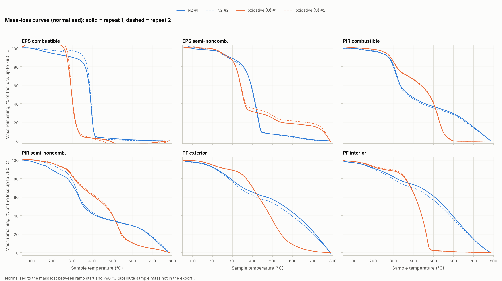
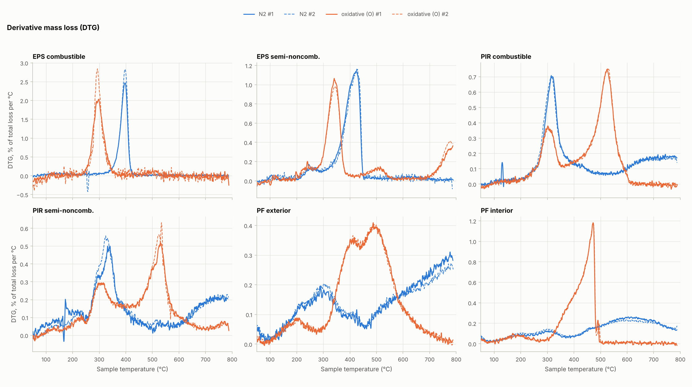
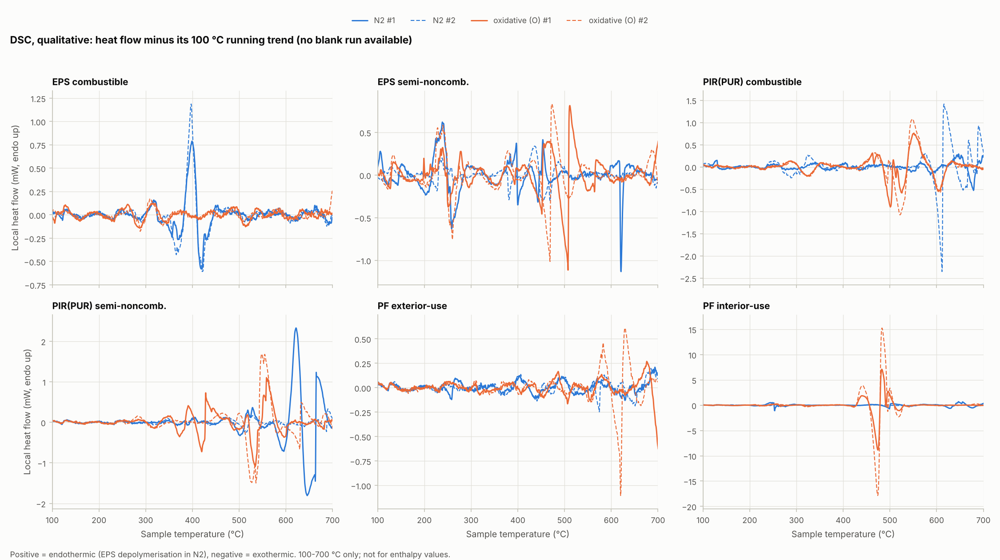
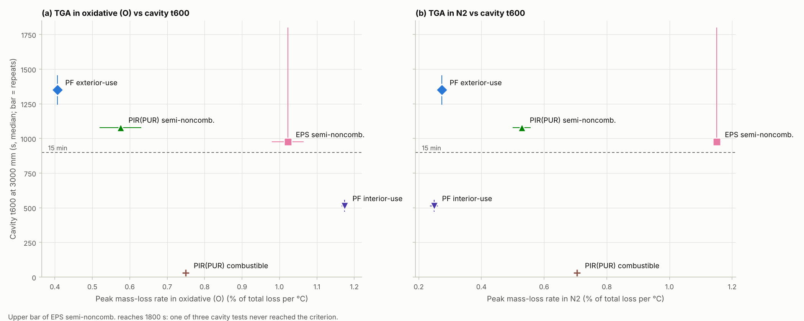

# TGA–DSC 분석 – 단열재 6종의 열분해·산화 특성과 중공층 화재시험 연계

대상 자료는 PerkinElmer STA(TGA–DSC 동시측정) 원자료 24개입니다. 질소(N)와 산화 분위기(O)에서 단열재 6종을 각각 2회씩 측정했습니다.

모든 수치·그림은 `python analysis.py`로 재현됩니다(→ [부록](#부록-재현-방법과-산출물)). 그림 안의 글자는 영문입니다.

## 0. 결론 – "기존 중공층 시험 자료와 같이 분석할 수 있는가?"

**네, 분석할 수 있고 중요한 연결고리가 하나 나왔습니다.** 다만 원자료에 시료 초기 질량이 없어서 잔류율(%)은 아직 계산할 수 없습니다.

1. **준불연 재료 4종에서는 공기(O) 분위기의 최대 질량감소속도 순서가 중공층 시험의 화재확산 순서와 정확히 같습니다.**
   - 최대 질량감소속도: PF 내부용 1.17 > EPS 준불연 1.02 > PIR(PUR) 준불연 0.58 > PF 외부용 0.41 %/°C
   - 3000 mm 기준 도달시간 t₆₀₀(중앙값): PF 내부용 514 < EPS 준불연 975 < PIR(PUR) 준불연 1080 < PF 외부용 1350 s
   - 순위상관 Spearman ρ = 1.0(준불연 4종)입니다. 질소 분위기에서는 이 관계가 없습니다.
   - 즉 준불연 재료의 중공층 확산속도는 **열분해 속도보다 공기 중 산화 분해 속도와 맞습니다.**
   - **가연성 PIR(PUR)은 이 관계에서 벗어납니다.** 공기 중 r_max는 0.75로 중간인데, 중공층에서는 30 s 만에 전체가 화염에 잠겼습니다(t₆₀₀ 29–31 s). 5종으로 계산하면 ρ = 0.7입니다. TGA 질량감소로는 준불연 처리(난연)의 효과가 드러나지 않는다는 뜻입니다([통합 평가식](../integrated_model/README.md)).
2. **PF 준불연 내부용과 외부용의 차이를 재료 수준에서 설명합니다.**
   - 질소에서는 두 PF의 열분해가 사실상 같습니다(전환율 50 % 온도 546 vs 544 °C).
   - 공기에서는 내부용이 472 °C 부근에서 급격히 전소합니다. 최대속도가 2.9배이고, 90 % 소실 온도가 474 °C로 외부용(591 °C)보다 117 °C 낮습니다. 같은 온도에서 DSC에 큰 발열(−9 ~ −18 mW)이 나타납니다.
   - 내부용의 탄화층이 산화에 훨씬 취약하다는 뜻입니다. 중공층 시험에서 PF 중 내부용만 III등급(R = 12)이 나온 이유와 맞습니다.
3. **EPS는 한 번에 급격히 분해하고, PIR(PUR)은 두 단계로 분해합니다.**
   - EPS 가연성은 질소 397 °C에서 한 단계로 급격히 분해합니다(2.65 %/°C).
   - 준불연 EPS는 분해 온도가 27 °C 높고(425 °C) 속도가 절반입니다(1.15 %/°C).
   - PIR(PUR)은 316–328 °C의 1단계 분해 뒤, 공기에서 525–532 °C에 탄화층 산화(2단계)가 일어납니다. 준불연 PIR(PUR)의 중공층 '이동 연소대 + 상부 재성장' 양상과 부합합니다.
4. **현재 자료로 할 수 없는 것과 필요한 자료**
   - 잔류율(char yield, %)과 J/g 단위 발열량: **시료 초기 질량(mg) 24개**가 필요합니다. 원자료의 질량 열에 절대 영점이 없습니다(여러 시험이 음수로 시작).
   - DSC 정량(엔탈피, 비열): **빈 도가니(blank)** 측정이 필요합니다. 블랭크가 없어 DSC는 발열·흡열의 온도와 방향만 봤습니다.
   - O 분위기가 공기인지 순수 산소인지 확인이 필요합니다.

---

## 1. 데이터와 처리

| 재료 | 파일 | 중공층 시험 |
|---|---|---|
| EPS 가연성 | `eps_c_1·2` | EPS_C(기록 4분, 등급 판정 제외) |
| EPS 준불연 | `eps_sc_1·2` | EPS_SC-1·2·3 |
| PIR(PUR) 가연성 | `pir_c_1·2` | PIR_C-1·2 |
| PIR(PUR) 준불연 | `pir_sc_1·2` | PIR_SC-1·2 |
| PF 준불연 외부용 | `pf_outter_1·2` | PF_out-1·2 |
| PF 준불연 내부용 | `pf_inner_1·2` | PF_in-1·2 |

- **측정 조건**: 5 °C/min 승온, 질소는 20 → 800 °C, O는 30 → 800 °C, 가스 20 mL/min입니다. 시작 전 약 5분 등온이 있고, 0.125초 간격(8 Hz)으로 기록됐습니다.
- **처리**
  - 승온 구간만 쓰고, 온도축은 시료 온도입니다. 약 2.5 °C 폭으로 평활화한 뒤 0.5 °C 간격으로 다시 나눴습니다.
  - **전환율 α** = (승온 시작 질량 − 현재 질량) / (승온 시작 ~ 790 °C 사이의 총 질량감소)입니다. 절대 영점이 없어서 총 질량감소로 정규화했습니다.
  - **T_α5·T_α50·T_α90**은 총 질량감소의 5·50·90 %가 일어난 온도입니다. 일반적인 'T5%(초기 질량의 5 % 감소)'와 정의가 다르므로 혼용하지 마십시오.
  - **T_onset**은 주 DTG 피크에서 그은 접선의 외삽 시작온도이고, **r_max**는 최대 질량감소속도(총 감소의 %/°C)입니다.
  - **f₄₀₀**은 400 °C 이상에서 일어난 질량감소의 비율입니다(고온 탄화층 분해·산화의 몫).
- **DSC 부호 확인**: EPS 해중합(흡열로 알려진 반응)이 질소에서 양(+)으로 나옵니다. 따라서 이 장비 출력은 **흡열 = +, 발열 = −**입니다.
- **자료 품질 메모**
  - EPS 가연성의 O 분위기 시료는 질량감소가 0.16–0.30 mg에 불과해 잡음이 큽니다(그림 1에서 100 %를 넘는 구간).
  - EPS 가연성 질소 #1은 100–380 °C에서 서서히 질량이 줄어 T_α5가 #2와 144 °C 다릅니다. T_α50과 피크 온도는 두 시험이 일치합니다.

## 2. 재료별 열분해·산화 특성





| 재료 | 분위기 | T_α5 (°C) | T_onset (°C) | 주 피크 (°C) | r_max (%/°C) | T_α50 (°C) | T_α90 (°C) | f₄₀₀ |
|---|---|---|---|---|---|---|---|---|
| EPS 가연성 | N₂ | 265 | 373 | 397 | 2.65 | 392 | 409 | 0.28 |
| EPS 가연성 | O | 275 | 275 | 296 | 2.44 | 299 | 333 | 0.03 |
| EPS 준불연 | N₂ | 242 | 362 | 425 | 1.15 | 404 | 444 | 0.54 |
| EPS 준불연 | O | 246 | 301 | 343 | 1.02 | 351 | 756 | 0.33 |
| PIR(PUR) 가연성 | N₂ | 241 | 276 | 317 | 0.70 | 374 | 727 | 0.46 |
| PIR(PUR) 가연성 | O | 263 | 463 | 525 | 0.75 | 480 | 549 | 0.67 |
| PIR(PUR) 준불연 | N₂ | 173 | 266 | 328 | 0.53 | 362 | 736 | 0.43 |
| PIR(PUR) 준불연 | O | 224 | 403 | 532 | 0.58 | 472 | 606 | 0.63 |
| PF 준불연 외부용 | N₂ | 168 | 421 | (745)* | 0.27 | 544 | 749 | 0.64 |
| PF 준불연 외부용 | O | 198 | 340 | 490 | 0.41 | 460 | 591 | 0.70 |
| PF 준불연 내부용 | N₂ | 151 | 355 | 611 | 0.25 | 546 | 723 | 0.72 |
| PF 준불연 내부용 | O | 176 | 398 | 472 | 1.17 | 428 | 474 | 0.65 |

반복 2회 평균입니다. 시료가 매우 작은 EPS 가연성을 빼면, 반복 간 차이는 피크 온도 ±6 °C, r_max ±0.06 %/°C 이내입니다(`results/tga_summary.csv`의 `_halfrange`).

\* PF는 질소에서 뚜렷한 주 피크 없이 800 °C까지 질량감소가 계속 빨라집니다. 750 °C 이하에서 찾은 최대값입니다.

- **EPS 가연성**: 질소에서 397 °C 한 단계로 거의 전량이 급격히 분해합니다(해중합, 흡열). 공기에서는 주분해가 약 100 °C 낮은 296 °C로 내려옵니다. 가연성 가스(단량체)를 짧은 온도 구간에 한꺼번에 내놓는 재료입니다.
- **EPS 준불연**
  - 가연성 EPS보다 분해 온도가 27 °C 높고(425 °C) 최대속도가 절반 이하입니다. 난연 처리 효과로 볼 수 있습니다.
  - 공기에서는 343 °C에서 주분해가 일어난 뒤 질량의 약 20 %가 700 °C 이상까지 남았다가 타 없어집니다. 흑연계 첨가제 같은 고온 산화 성분일 가능성이 있습니다(추정, 제품 구성 확인 필요).
- **PIR(PUR) 가연성·준불연**
  - 질소 1단계(316–328 °C)는 우레탄·이소시아누레이트 결합의 분해이고, 공기 2단계(525–532 °C)는 탄화층 산화입니다.
  - 준불연 PIR(PUR)은 1단계가 더 이르게 시작합니다(T_α5 173 vs 241 °C). 대신 속도가 낮고(0.53 vs 0.70), 공기에서 탄화층이 더 오래 남습니다(T_α90 606 vs 549 °C).
- **PF 준불연 외부용·내부용**
  - 질소에서는 넓은 다단계 분해가 800 °C까지 이어지며 두 제품이 거의 같습니다.
  - 공기에서 **내부용은 472 °C에서 급격히 전소**하고(1.17 %/°C, T_α90 474 °C), 외부용은 490 °C를 정점으로 완만하게 산화합니다(0.41 %/°C, T_α90 591 °C).
  - 내부용의 급격한 전소와 큰 발열은 시료가 도가니 안에서 자체 착화(열폭주)했을 가능성을 시사합니다.

## 3. DSC (정성)



열류에서 100 °C 이동추세를 빼서 국소 사건만 남긴 그림입니다. 크기(mW)는 비교용이며 엔탈피 값으로 쓰면 안 됩니다.

- **EPS 가연성(N₂)**: 397–399 °C에서 흡열(+0.8 ~ +1.2 mW)이 나타납니다. 해중합과 일치하고, 이 신호로 부호를 확인했습니다.
- **PF 준불연 내부용(O)**: 474 °C에서 다른 모든 시료보다 한 자릿수 큰 **발열(−9, −18 mW)**이 나타납니다. 질량이 급격히 사라지는 온도와 같습니다.
- 그 밖의 신호는 ±2 mW 이하로, 추세 제거 방식이 만드는 잡음과 구분되지 않습니다. 결론을 내리지 않았습니다.
- 넓은 구간의 열량을 직선 기준선으로 적분해 보면 PIR(PUR) 준불연이 연소열보다 큰 −50 kJ/g(질량감소 기준) 수준이 나옵니다. 이는 기준선 문제이므로 **엔탈피 값은 보고하지 않습니다.**

## 4. 중공층 화재시험과의 연계



| 재료 | t₆₀₀ 중앙값 (s) | D₆₀₀ 중앙값 (분) | R(최대) | O: r_max (%/°C) | O: 주 피크 (°C) | O: T_α90 (°C) | N₂: r_max (%/°C) |
|---|---|---|---|---|---|---|---|
| PIR(PUR) 가연성 | **30** | 15.5 | 16 | 0.75 | 525 | 549 | 0.70 |
| PF 준불연 내부용 | 514 | 14.0 | 12 | **1.17** | 472 | 474 | 0.25 |
| EPS 준불연 | 975 | 0.6 | 4 | **1.02** | 343 | 756 | 1.15 |
| PIR(PUR) 준불연 | 1080 | 5.8 | 6 | **0.58** | 532 | 606 | 0.53 |
| PF 준불연 외부용 | 1350 | 3.7 | 4 | **0.41** | 490 | 591 | 0.27 |

- **준불연 4종의 확산속도와 맞는 것은 공기 중 최대 질량감소속도입니다(ρ = 1.0).** 질소 지표들은 맞지 않습니다. 가연성 PIR(PUR)을 넣은 5종으로는 ρ = 0.7입니다(전체 `results/fire_link_rank.csv`).
  - 중공층 안에서는 공기가 공급되는 상태로 단열재가 가열됩니다. 그래서 산화 분해와 탄화층 연소가 얼마나 빨리 일어나느냐가 위층으로 번지는 속도를 정한다고 해석할 수 있습니다.
  - 특히 PF 두 제품은 질소 거동이 같은데 공기 거동만 달라서, 이 해석을 뒷받침하는 가장 직접적인 근거입니다.
- **가연성 PIR(PUR)은 TGA로 설명되지 않습니다.**
  - TGA로 보면 가연성이 준불연보다 오히려 안정적입니다. 공기 중 분해 시작온도(T_onset 463 vs 403 °C)와 5 % 소실 온도(263 vs 224 °C)가 더 높고, r_max 차이(0.75 vs 0.58)도 작습니다.
  - 그런데 중공층에서는 30 s 대 18분으로 35배 빨랐습니다. 준불연 등급의 효과(기상 난연, 면재 등)가 질량감소 속도가 아니라 **불꽃의 착화·전파 단계**에서 작동한다는 뜻입니다. 이 효과는 콘칼로리미터(착화시간·열방출률)로 봐야 합니다.
- **고온 지속(D₆₀₀)을 하나로 설명하는 TGA 지표는 없습니다.** 다만 400 °C 이상에서 타는 질량 비율(f₄₀₀, O)이 가장 낮은 EPS 준불연(0.33)이 고온 지속도 가장 짧습니다(0.6분). 정성적으로는 맞습니다. 5종으로는 공기 중 T_onset이 D₆₀₀과 ρ = 0.9로 나오지만, 분해 시작이 늦을수록 오래 탄다는 물리적 근거가 없어 우연으로 봅니다.
- **예측과 결과**
  - EPS 가연성은 공기 중 최대속도가 2.44 %/°C로 6종 중 가장 큽니다. 중공층 기록이 4분뿐이라 확인할 수 없습니다.
  - 이전 판에서 "PIR 가연성(0.75)은 PIR 준불연(0.58)보다 빠르게 번질 것"으로 예상했습니다. 방향은 맞았지만 크기는 전혀 달랐습니다(예측 약 13분 → 실측 30 s).
- **주의**
  - 준불연 재료가 4종뿐입니다. 4종이 우연히 완전 일치할 확률은 1/24(약 4 %)이므로 '강한 정황'이지 확정은 아닙니다.
  - TGA 시료(수 mg)가 제품의 어느 부분(심재·표면 처리층)에서 채취됐는지에 따라 결과가 달라질 수 있습니다. 채취 위치를 확인해 주십시오.

**위험평가식과의 연결**([RISK_MODEL.md](../cavity_fire_index/RISK_MODEL.md))

1. **공기 중 r_max**는 콘 시험 재료지수 M과 함께 쓸 수 있는 **준불연 재료 선별용 '산화 반응성' 보조지표** 후보입니다. 가연성 등급에는 쓸 수 없고, 재료 종류를 늘려 검증해야 합니다.
2. **TGA 시작온도**는 TRP의 착화온도 ΔT_ig 대용으로 쓸 수 있습니다. 다만 분해 시작온도와 유염 착화온도는 다르므로 콘 착화시간에서 구한 실효 TRP를 우선합니다.
3. **비열 c**는 같은 장비로 **빈 도가니 + 사파이어 기준시료** 측정을 추가하면 온도별 비열 c(T)로 직접 구할 수 있습니다. 이 값은 위험식 TRP = ΔT_ig·√(πkρc/4)에 바로 들어갑니다.

## 5. 한계와 요청 사항

- [ ] 시료 초기 질량(mg) 24개(Pyris 보고서의 Sample Weight). 잔류율, J/g 발열량, T5%(표준 정의)를 계산하는 데 필요합니다.
- [ ] O 분위기 가스 종류(공기 / 산소)
- [ ] 같은 조건의 빈 도가니 측정(DSC·부력 기준선). 사파이어 측정까지 있으면 비열 c(T)를 구할 수 있습니다.
- [ ] 가열속도 2–3개 추가(예: 10·20 °C/min). Kissinger·Ozawa 방법으로 활성화에너지를 구해 열분해 모델에 쓸 수 있습니다.
- [ ] 시료 채취 위치(심재 / 표면층)와 준불연 처리 방식

---

## 부록: 재현 방법과 산출물

```bash
cd tga_dsc
python analysis.py                  # data/N/*.csv, data/O/*.csv  →  figures/, results/
```

- 원자료(`data/`)는 공개 저장소이므로 커밋하지 않습니다(`.gitignore`). 압축을 풀어 `data/N`, `data/O`에 넣으면 됩니다.
- 화재시험 연계는 `../cavity_fire_index/results/`의 `index_3000mm.csv`, `risk_model.csv`를 읽습니다.
- 산출물(`results/`)
  - `tga_metrics.csv` – 시험 24개별 지표
  - `tga_summary.csv` – 재료 × 분위기 평균과 반복 간 반폭
  - `fire_link.csv` – 재료별 중공층 지표와 TGA 지표
  - `fire_link_rank.csv` – TGA 지표별 Spearman 순위상관(확산속도, D₆₀₀)
